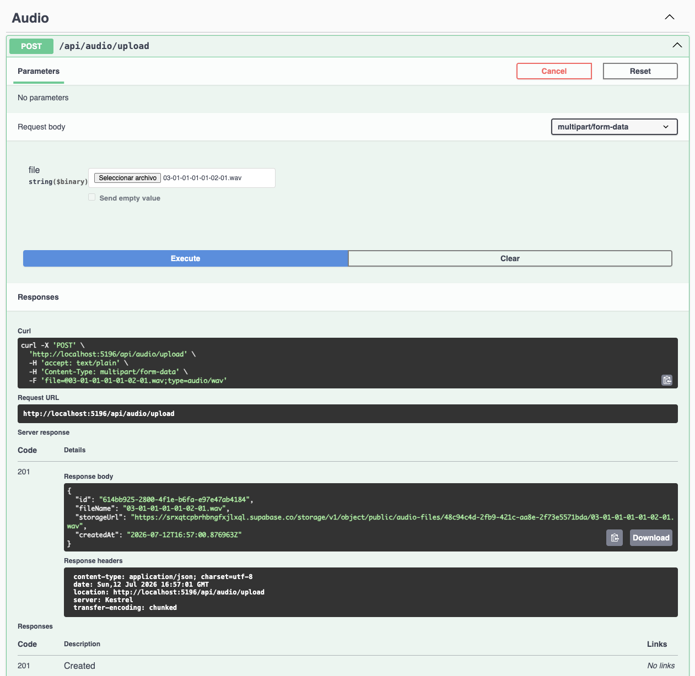
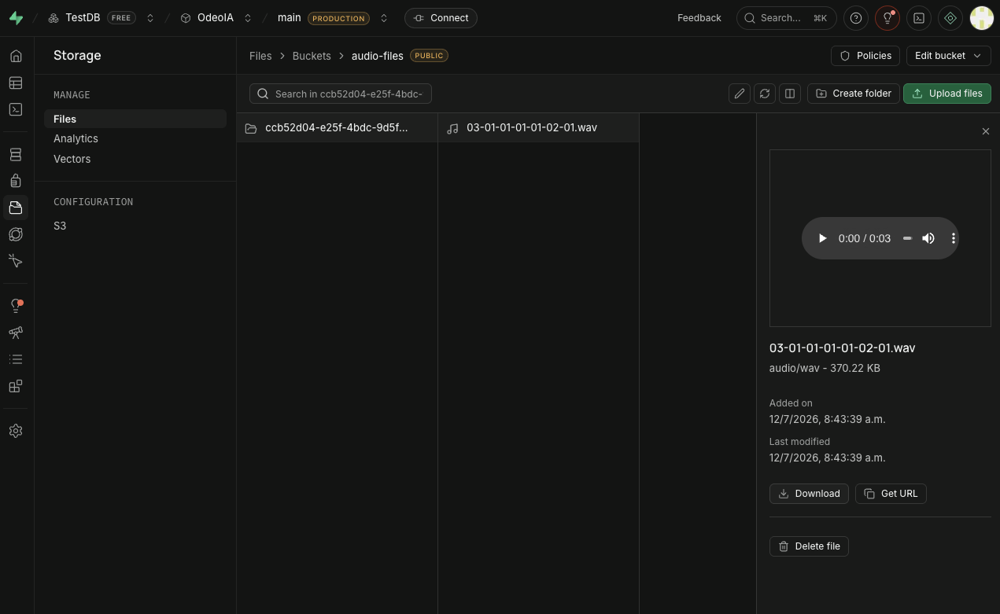
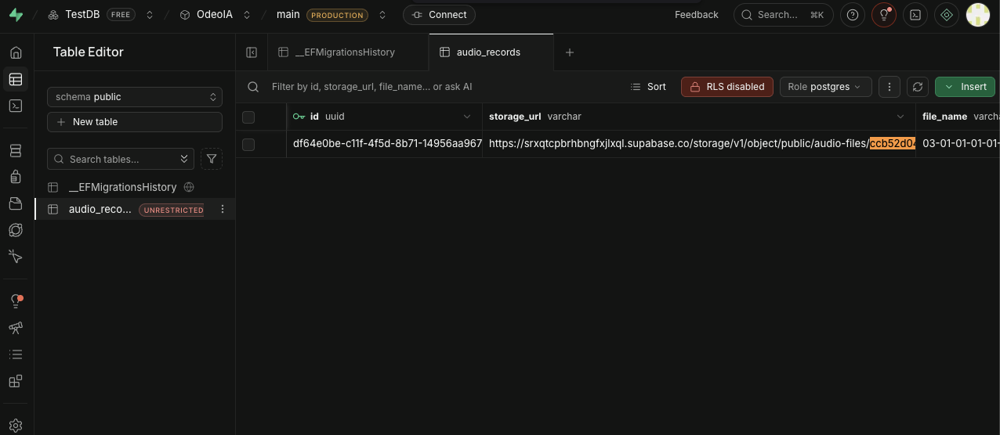

# Programming 7

## Lab Report: Lab #1

**Project Title:** OdeoIA - Audio Processor API
**Student Name:** Oscar Steven Muñoz Fajardo
**Student Email:** oscar.munoz@jala.university
**Submission Date:** 12/07/2026
**Instructor:** Leopoldo Flores

---

# 1. Introduction

### Overview

For this lab, I built the backend of **OdeoIA** using **C# .NET 10 Web API** following the **Clean Architecture** pattern. The API allows users to upload `.mp3` and `.wav` audio files, stores the files in **Supabase Storage**, and saves their metadata (UUID, filename, and public URL) in a **Supabase PostgreSQL** database.

### Target Objective

The main goal of this first phase was to build a solid foundation for the project. I focused on keeping a clear separation of responsibilities with Clean Architecture, using asynchronous operations for file uploads, containerizing the application with Docker, and managing configuration securely through environment variables.

---

# 2. Architecture & Implementation

## 2.1 Clean Architecture

I organized the project into four independent layers to keep the code easier to maintain and extend.

* **Domain:** Contains the core business entities, such as `AudioRecord`, without depending on any external libraries.
* **Application:** Contains the use cases, like `UploadAudioUseCase`, and defines the interfaces used by the application (`IAudioRepository` and `IAudioStorageService`).
* **Infrastructure:** Implements those interfaces using Entity Framework Core for PostgreSQL and the `supabase-csharp` SDK for storage.
* **API:** Exposes the REST endpoints through `AudioController` and configures dependency injection.

This structure helps me keep the business logic separated from the infrastructure, making future changes much easier.

---

## 2.2 Supabase Integration

I used Supabase for both file storage and the PostgreSQL database, so everything is managed from a single platform.

I implemented the `IAudioStorageService` to upload audio files, generate unique UUID-based filenames, and return the public URL after each upload. Once the upload is complete, the metadata is stored in the database.

---

## 2.3 DevOps & Automation

To make the project easier to run in different environments, I created a multi-stage `Dockerfile` for building and running the API.

I also added a `Makefile` with common development commands, such as running the tests, applying Entity Framework migrations, and starting the Docker containers. This helps reduce repetitive commands during development.

---

# 5. Execution Results & Empirical Evidence

## 5.1 Verification Evidence

### Evidence 1: Successful File Upload

**Description:** The API successfully receives an `.mp3` or `.wav` file through Swagger and returns a successful HTTP response.

---

### Evidence 2: File Stored in Supabase

**Description:** The uploaded audio file can be seen in the corresponding Supabase Storage bucket.

---

### Evidence 3: Metadata Saved in PostgreSQL

**Description:** The `audio_records` table contains the generated UUID, filename, and public URL of the uploaded file.

---

# 6. Self-Assessment, Blockers & Bugs

The biggest challenge during this lab was configuring Supabase because it was my first time working with it. Most of the time was spent understanding how to connect the application securely and how to manage the environment variables without exposing sensitive information.

Another challenge was making sure the same configuration worked both locally and inside Docker containers. After configuring everything correctly, using the `supabase-csharp` library made the integration much simpler since it provides support for both Storage and PostgreSQL from the same SDK.

---

# 7. Conclusions

One of the main concepts I applied in this lab was asynchronous programming.

If the API handled file uploads synchronously, each request would block the processing thread until the upload finished. This means the server would have to wait before processing other incoming requests, reducing its overall performance.

By using `async` and `await`, the thread is released while the file is being uploaded to Supabase. This allows the server to continue handling other requests instead of waiting for the upload to complete. As a result, the API becomes more responsive and can support multiple users more efficiently.

---

# 8. Recommendations

For the next phase of the project, I would like to continue improving the application by adding more functionality.

* Generate streaming URLs so uploaded audio files can be played directly from the frontend.
* Add client-side validation to prevent unsupported file formats before sending requests to the API.
* Implement a background processing service to automatically compress or transcode uploaded audio files after they are stored.
