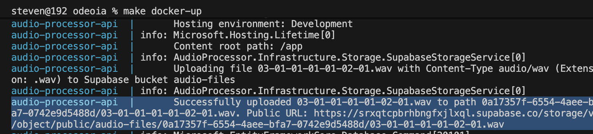
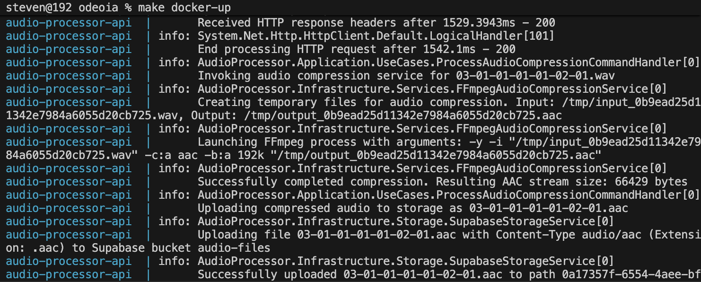
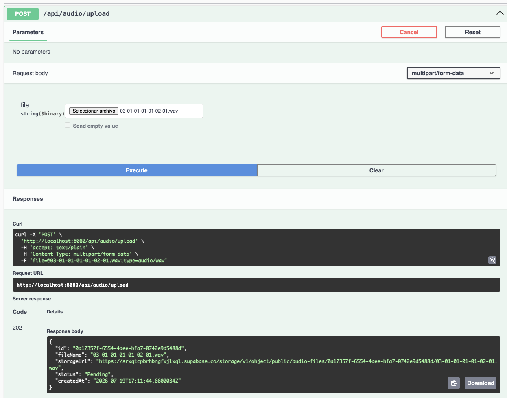
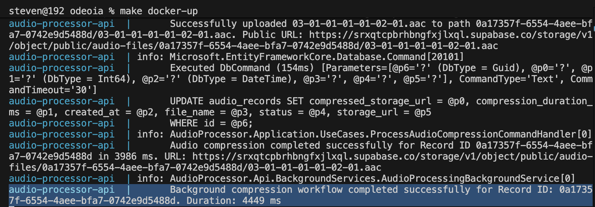
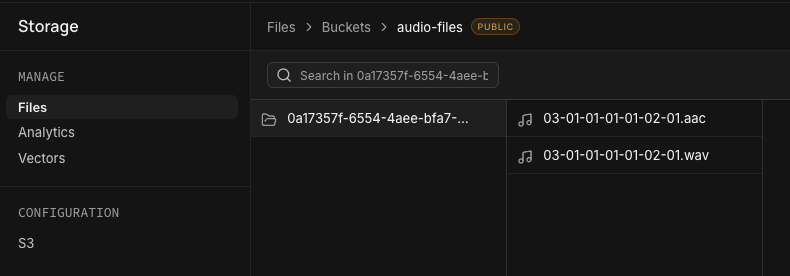

# Programming 7

## Lab Report: Lab #2
**Project Title:** OdeoIA - Audio Processor API.  
**Student Name:** Oscar Steven Muñoz Fajardo.  
**Student Email:** [oscar.munoz@jala.university](mailto:oscar.munoz@jala.university).  
**Submission Date:** 18/07/2026   
**Instructor:** Leopoldo Flores

---

# 1. Introduction

### Overview

In this lab cycle, I extended the OdeoIA Audio Processor API by implementing an asynchronous audio compression workflow using Clean Architecture principles. The main objective was to process uploaded `.mp3` and `.wav` audio files in the background instead of performing the compression during the HTTP request.

To achieve this, I implemented a producer-consumer architecture using **System.Threading.Channels** together with a hosted **BackgroundService**. This approach allows the API to respond immediately after receiving a file while the compression process continues independently, improving responsiveness and scalability.

### Target Objective

The objective of this milestone was to process CPU-intensive tasks asynchronously without blocking incoming requests. By moving the audio transcoding process to a background worker, the application can continue serving other users while the compression is executed independently, making better use of the available system resources.

---

# 2. Architecture & Implementation

The project follows the same Clean Architecture structure implemented during the first lab. This made it possible to introduce asynchronous processing without affecting the existing layers or coupling business logic to infrastructure-specific components.

## 2.1 Background Task Processing and Channels

To keep the API responsive while processing audio files, I implemented a **Producer-Consumer Pattern**.

### The Producer (HTTP Endpoint)

The `UploadAudioFile` endpoint receives the audio file, uploads it to Supabase Storage, creates the corresponding database record with a **Pending** status, and sends the record identifier to a background queue.

Instead of waiting for the compression to finish, the endpoint immediately returns **HTTP 202 (Accepted)**, indicating that the request has been received and that the processing will continue asynchronously.

### The Channel Buffer

The queue is implemented using **System.Threading.Channels**, specifically through a bounded channel that safely stores pending jobs until the background worker is ready to process them.

Using a bounded queue also prevents excessive memory usage if many requests arrive simultaneously.

### The Consumer (BackgroundService)

A hosted background service continuously waits for new jobs in the queue. Whenever a new audio record is available, it retrieves the necessary services from the dependency injection container and executes the complete compression workflow.

This process includes downloading the original file, compressing it with FFmpeg, uploading the resulting AAC file, and updating the processing status in the database.

---

## 2.2 Layer Division and Code Mechanics

### Domain Layer

The Domain layer contains the core business rules. The `AudioRecord` entity is responsible for tracking the processing state of each uploaded file using the values **Pending**, **Processing**, **Completed**, and **Failed**.

Encapsulating these state transitions inside the entity helps keep the business rules consistent throughout the application.

### Application Layer

The Application layer contains the use cases and interfaces that coordinate the compression workflow.

The `ProcessAudioCompressionCommandHandler` orchestrates the entire process by downloading the original audio, invoking the compression service, storing the compressed version, and updating the record status once the operation finishes.

### Infrastructure Layer

The Infrastructure layer provides the concrete implementations required by the application.

Some of the main components include:

* **FFmpegAudioCompressionService**, responsible for invoking FFmpeg to compress audio files.
* **ChannelBackgroundJobQueue**, which manages the in-memory queue for background processing.
* **SupabaseStorageService**, used to upload and retrieve both the original and compressed audio files.

Keeping these implementations isolated makes the application easier to maintain and allows infrastructure components to evolve without affecting the business logic.

---

# 3. Pull Request (PR)

**Pull Request Link**

[https://gitlab.com/jala-university1/cohort-2/ES.CSPR-471.GA.T2.26.M1/SB/oscar.munoz/odeoia/-/merge_requests/2](https://gitlab.com/jala-university1/cohort-2/ES.CSPR-471.GA.T2.26.M1/SB/oscar.munoz/odeoia/-/merge_requests/2)

---

## 4. Benchmark & Performance Measurements

| Execution Strategy                    | Dataset / Load Profile Details                                                                                                       |                                              Execution Time (ms) | Resource Metrics (CPU % / RAM MB) |
| :------------------------------------ | :----------------------------------------------------------------------------------------------------------------------------------- | ---------------------------------------------------------------: | :-------------------------------- |
| **Sequential / Baseline**             | Upload and audio compression executed during the same HTTP request. Test file: **379 KB (.mp3)**.                                    |                                                   **≈ 4,500 ms** | **CPU ≈ 15% / RAM ≈ 197 MB**      |
| **Optimized (Background Processing)** | Upload request returns immediately (HTTP 202) while compression runs asynchronously in the background. Test file: **379 KB (.mp3)**. | **HTTP Response:** **1,140 ms** **Compression:** **3,399 ms** | **CPU: 14.58% / RAM: 197.4 MB**   |

### Performance Analysis

The benchmark shows that the main improvement is not reducing the compression time itself, but reducing the time the client has to wait for a response. In a traditional synchronous implementation, the request would remain blocked until the audio compression finished, resulting in an estimated response time of approximately **4.5 seconds** for the tested file.

With the asynchronous implementation, the API returns **HTTP 202 Accepted** in approximately **1.14 seconds**, while the compression continues independently in the background and completes in **3.4 seconds**. This allows the server to continue processing new incoming requests without occupying request-handling threads with CPU-intensive work.

During execution, the container maintained a CPU utilization of approximately **14.58%** and a memory consumption of about **197 MB**, demonstrating stable resource usage while processing the compression task asynchronously. Although the total compression time remains similar, the user experience and the application's scalability improve significantly because long-running operations no longer block HTTP requests.

### Threading Considerations (Question lab)

At this stage of the project, introducing threading-related concepts is appropriate because the application now performs long-running, CPU-intensive tasks that should not execute directly within the HTTP request lifecycle.

Instead of creating or managing threads manually, the implementation relies on the abstractions provided by .NET, such as BackgroundService, System.Threading.Channels, and the ThreadPool. This allows the runtime to efficiently schedule work without increasing the complexity of the application.

Using these concurrency mechanisms improves responsiveness by allowing HTTP requests to finish quickly while background workers handle the audio compression process independently. For this reason, this milestone represents an appropriate point to introduce threading concepts, since they solve a real performance and scalability problem rather than being used unnecessarily.

---

# 5. Execution Results & Empirical Evidence

The following evidence demonstrates that the asynchronous processing pipeline works correctly from receiving the upload request to generating the compressed audio file.

## 5.1 Console Outputs & Logs

The following console output shows the application running successfully. The logs confirm that the background service starts correctly, processes queued audio files, executes the compression task, and updates the processing status once the operation completes.

 

---

## 5.2 Screenshots / Visual Proof

### HTTP 202 Response

The following screenshot shows the Swagger endpoint returning **HTTP 202 Accepted**, confirming that the request is accepted immediately while the compression continues in the background.

---

### Successful Background Processing

The application logs confirm that the background worker completed the compression process successfully and updated the corresponding audio record.

  

---

### Storage Verification

The following screenshot verifies that both the original uploaded audio and the generated compressed AAC file were successfully stored in Supabase Storage.

