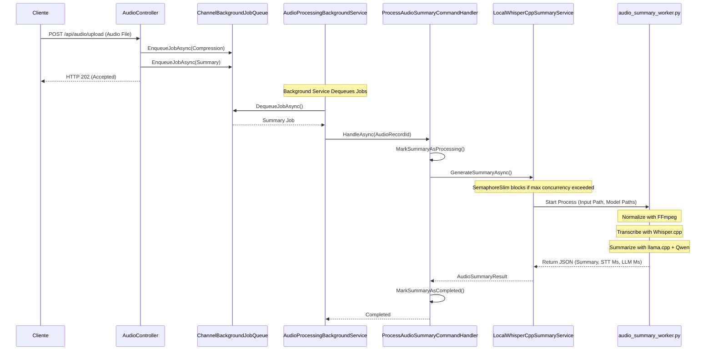
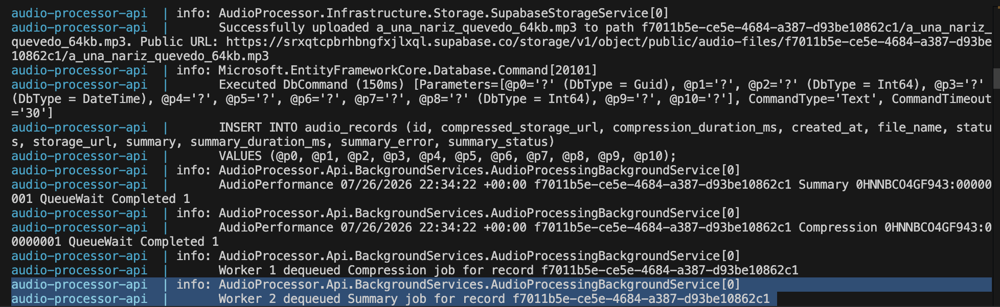
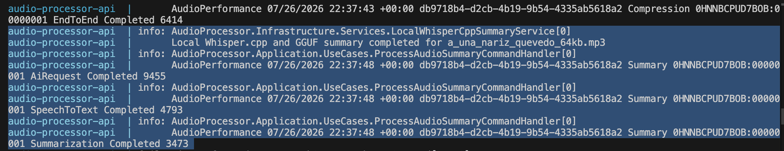
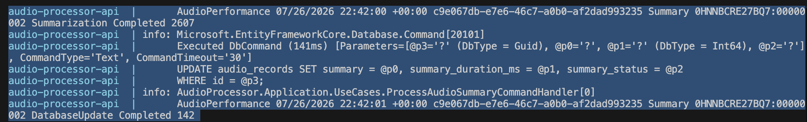
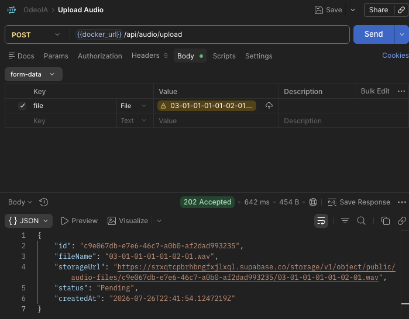
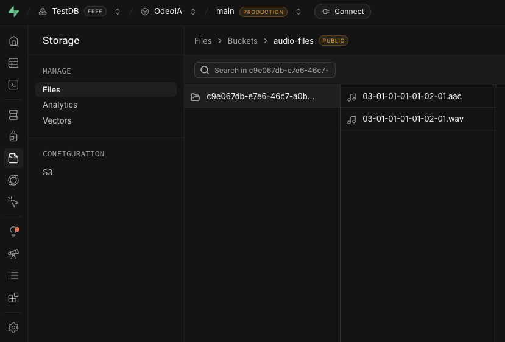
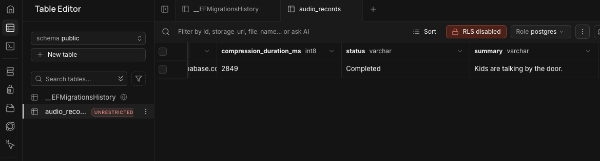
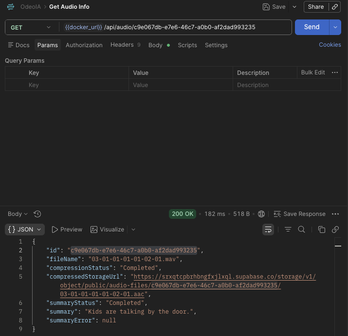
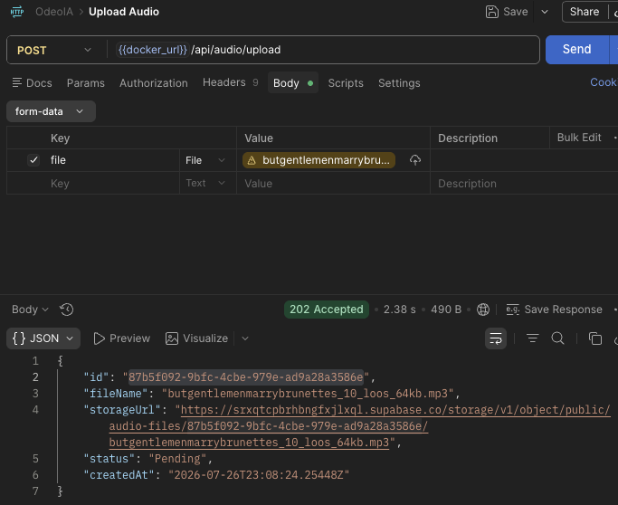
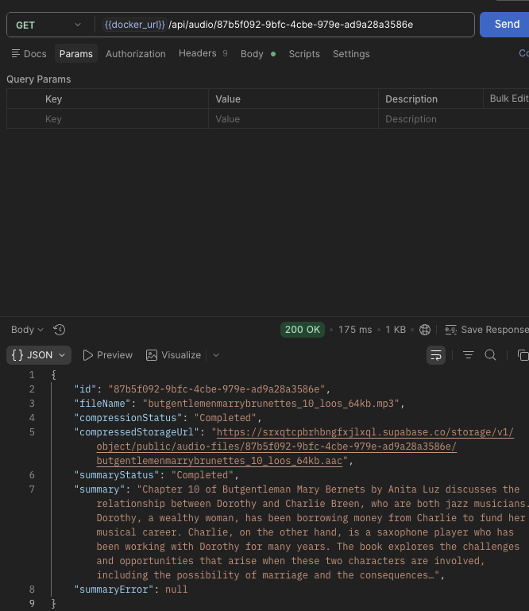

# Programming 7
## Lab Report: Lab #3

**Project Title:** OdeoIA - Audio Processor API  
**Student Name:** Oscar Steven Muñoz Fajardo  
**Student Email:** oscar.munoz@jala.university  
**Submission Date:** 26/07/2026  
**Instructor:** Leopoldo Flores  

---

## 1. Introduction
**Overview:** En este laboratorio extendí OdeoIA incorporando la funcionalidad de generación automática de resúmenes de audio. Para mantener la API responsiva, el procesamiento se realiza de forma asíncrona mediante un BackgroundService, que delega la transcripción y la generación del resumen a un Worker desarrollado en Python.

El Worker utiliza Whisper.cpp para convertir el audio en texto y Qwen, ejecutado mediante llama.cpp, para generar el resumen de forma local. De esta manera, las tareas más costosas desde el punto de vista computacional se ejecutan fuera del ciclo de vida de la petición HTTP, evitando bloquear el servidor mientras el procesamiento continúa en segundo plano.

**Target Objective:** El objetivo principal de este laboratorio fue implementar un pipeline asíncrono para el procesamiento de tareas intensivas en CPU, como la transcripción de audio (Speech-to-Text) y la generación de resúmenes mediante un modelo de lenguaje.

Al desacoplar estas tareas de la petición HTTP original, la aplicación puede responder rápidamente al cliente con un HTTP 202 (Accepted) mientras el procesamiento continúa en segundo plano. Esto mejora la experiencia del usuario, evita bloquear los hilos encargados de atender nuevas solicitudes y permite aprovechar de forma más eficiente los recursos disponibles del servidor.

---

# 2. Architecture & Implementation

La funcionalidad de generación de resúmenes de audio se implementó respetando la separación de responsabilidades definida por **Clean Architecture**. Para evitar que las tareas de inteligencia artificial bloquearan las solicitudes HTTP, el procesamiento se desacopló mediante un flujo asíncrono basado en **BackgroundService** y **System.Threading.Channels**. De esta forma, la API puede responder inmediatamente al cliente mientras el resumen se genera en segundo plano. 

---

## 2.1 Flujo Completo del Audio Summary

El procesamiento comienza cuando un cliente carga un archivo de audio a través del endpoint correspondiente. En ese momento, el archivo se almacena en Supabase Storage y se registra un nuevo `AudioRecord` en PostgreSQL con la información inicial del procesamiento.

Una vez almacenado el archivo, el controlador crea dos trabajos independientes para el mismo registro: uno encargado de la compresión del audio y otro de la generación del resumen. Ambos trabajos se envían a una cola en memoria y el endpoint responde inmediatamente con un **HTTP 202 (Accepted)**, indicando que la solicitud fue recibida correctamente y que el procesamiento continuará de forma asíncrona.

Mientras el cliente ya recibió la respuesta, el **BackgroundService** consume los trabajos pendientes de la cola y ejecuta el caso de uso correspondiente. En el caso del resumen, el flujo continúa llamando al servicio encargado de iniciar el Worker de Python, el cual realiza el preprocesamiento del audio, la transcripción con Whisper.cpp y finalmente la generación del resumen utilizando Qwen mediante llama.cpp.

Una vez finaliza el procesamiento, el Worker devuelve el resumen generado junto con las métricas de tiempo de ejecución. Finalmente, el caso de uso actualiza el estado del registro en la base de datos y marca el procesamiento como completado. 

---

## 2.2 Productor y Consumidor mediante Channels y BackgroundService

La comunicación entre el controlador y el procesamiento en segundo plano sigue el patrón **Productor-Consumidor**, permitiendo desacoplar la recepción de solicitudes del trabajo intensivo que realiza la inteligencia artificial.

### El Productor

El `AudioController` actúa como productor. Después de recibir el archivo, crear el registro en la base de datos y almacenar el audio, envía un nuevo `AudioProcessingJob` a la cola para que sea procesado posteriormente por el servicio en segundo plano.

### La Cola

La cola se implementa mediante `System.Threading.Channels`, utilizando un canal acotado (`Channel<T>`) con capacidad para 100 elementos. Esta estrategia permite controlar el consumo de memoria y evitar que un alto número de solicitudes simultáneas provoque un crecimiento descontrolado de trabajos pendientes.

### El Consumidor

El `AudioProcessingBackgroundService` permanece ejecutándose durante todo el ciclo de vida de la aplicación. Su responsabilidad es leer continuamente los trabajos disponibles en la cola y delegar su ejecución al caso de uso correspondiente.

Para aprovechar mejor los recursos disponibles, el servicio crea un conjunto de tareas consumidoras cuyo tamaño se calcula dinámicamente según la cantidad de procesadores disponibles en el equipo. Esto permite procesar múltiples trabajos sin crear más procesos de los que el hardware puede manejar eficientemente. 

---

## 2.3 Integración con Whisper y Qwen (Python Worker)

La generación del resumen se realiza mediante un Worker desarrollado en Python, el cual ejecuta localmente las herramientas necesarias para procesar el audio y generar el texto resumido.

El procesamiento se divide en tres etapas principales.

### Normalización del audio

Antes de iniciar la transcripción, el Worker utiliza **FFmpeg** para convertir el archivo recibido a un formato uniforme de **16 kHz**, canal mono y codificación `pcm_s16le`. Esta normalización garantiza que Whisper.cpp procese todos los audios bajo las mismas condiciones.

### Transcripción (Speech-to-Text)

Una vez normalizado el audio, el Worker ejecuta **Whisper.cpp** utilizando el modelo cuantizado `ggml-tiny.en-q5_1.bin`. El resultado de esta etapa es la transcripción completa del audio en formato de texto.

### Generación del resumen

Si la transcripción se realizó correctamente, el Worker construye un prompt y ejecuta **llama.cpp** utilizando el modelo `qwen2.5-0.5b-instruct-q5_k_m.gguf`.

Finalmente, la salida generada por el modelo se procesa para eliminar la información adicional producida por la herramienta de línea de comandos y conservar únicamente el texto correspondiente al resumen. 

---

## 2.4 Comunicación entre C# y el Worker de Python

La comunicación entre la aplicación desarrollada en C# y el Worker implementado en Python se realiza mediante procesos externos del sistema operativo.

La clase `LocalWhisperCppSummaryService` es la responsable de iniciar el Worker, esperar su finalización y transformar la respuesta obtenida en un objeto que pueda utilizar el resto de la aplicación.

Durante este proceso también se implementaron varios mecanismos para garantizar una ejecución segura.

* **Control de concurrencia:** Se utiliza un `SemaphoreSlim` para limitar la cantidad de procesos de inferencia ejecutándose simultáneamente y evitar la saturación de la CPU.

* **Lectura asíncrona de la salida del proceso:** Los flujos `stdout` y `stderr` se consumen de forma independiente para evitar bloqueos mientras el Worker se encuentra en ejecución.

* **Cancelación y tiempos de espera:** El servicio utiliza el mismo `CancellationToken` del `BackgroundService` y define un tiempo máximo de ejecución. Si el proceso excede ese límite o la aplicación se detiene, el Worker y todos sus procesos hijos son finalizados de forma segura.

* **Intercambio de datos:** El Worker devuelve un único objeto JSON con el resumen generado y las métricas de ejecución. La aplicación deserializa este resultado y actualiza el estado del procesamiento en la base de datos, mientras que los mensajes de depuración continúan registrándose mediante el sistema de logging de .NET. 

---

## 2.5 División por Capas (Clean Architecture)

La implementación del flujo de generación de resúmenes mantiene la misma organización por capas utilizada en el resto del proyecto.

### Domain

La entidad `AudioRecord` se amplió para almacenar la información relacionada con el resumen, incluyendo el texto generado, el estado del procesamiento, la duración de la ejecución y cualquier error ocurrido durante el proceso. Además, las reglas de negocio asociadas a estos cambios permanecen encapsuladas dentro del modelo de dominio.

### Application

La capa de aplicación incorpora el caso de uso `ProcessAudioSummaryCommandHandler`, la interfaz `IAudioSummaryService` y el modelo `AudioPerformanceLog`, encargado de centralizar las métricas de rendimiento generadas durante el procesamiento.

### Infrastructure

La infraestructura implementa el servicio `LocalWhisperCppSummaryService`, responsable de ejecutar el Worker de Python utilizando las configuraciones definidas mediante `LocalModelWorkerOptions`.

### API

La capa API continúa siendo responsable de recibir las solicitudes HTTP, registrar los trabajos en la cola y coordinar el inicio del procesamiento en segundo plano mediante el `AudioProcessingBackgroundService`. 

---

## 3. Pull Request (PR)
* **Pull Request Link:** https://gitlab.com/jala-university1/cohort-2/ES.CSPR-471.GA.T2.26.M1/SB/oscar.munoz/odeoia/-/merge_requests/3

---

# 4. Benchmark & Performance Measurements

Las siguientes mediciones fueron obtenidas a partir de los registros de rendimiento generados por la aplicación durante el procesamiento de un archivo de audio. Estos tiempos permiten observar cuánto tarda cada etapa del pipeline y facilitan identificar cuáles son las operaciones que consumen más tiempo durante la generación del resumen. 

| Operation                     |                        Time |
| :---------------------------- | --------------------------: |
| Audio Download                |                 **1284 ms** |
| FFmpeg Preprocessing          | *Not measured individually* |
| Whisper Transcription         |                 **1668 ms** |
| Qwen Summarization            |                 **2607 ms** |
| AI Processing                 |                 **5121 ms** |
| Database Update               |                  **142 ms** |
| Total Summary Process         |                 **6541 ms** |
| Complete Summary Pipeline     |                 **6836 ms** |
| Audio Compression             |                 **1007 ms** |
| Complete Compression Pipeline |                 **3140 ms** |

> **Note**
>
> El tiempo correspondiente al preprocesamiento con FFmpeg no se registra de forma independiente, ya que esta operación se ejecuta dentro del Worker de Python antes de iniciar la transcripción. Sin embargo, forma parte del tiempo total registrado para el procesamiento de la inteligencia artificial. 

### Performance Analysis

Los resultados muestran que la etapa que más tiempo consume es la generación del resumen con **Qwen**, seguida por la transcripción realizada con **Whisper.cpp**. Esto es esperado, ya que ambas tareas realizan el procesamiento de inteligencia artificial y representan la mayor carga de trabajo dentro del pipeline.

Por otro lado, operaciones como la actualización de la base de datos tienen un impacto muy pequeño en el tiempo total de ejecución. Esto permite concluir que el principal costo del procesamiento se encuentra en la inferencia de los modelos y no en la comunicación con la base de datos o el almacenamiento.

Otra ventaja de registrar el tiempo de cada etapa es que resulta mucho más sencillo identificar posibles cuellos de botella. Si en futuras versiones el procesamiento aumenta considerablemente, estos registros permitirán determinar rápidamente si el problema se encuentra en la descarga del archivo, la transcripción, la generación del resumen o cualquier otra etapa del flujo.

Actualmente, la solución utiliza el modelo **`ggml-tiny.en-q5_1.bin`** para realizar la transcripción. Debido a que se trata de un modelo entrenado únicamente para **inglés**, el sistema solo genera resúmenes correctamente cuando el audio se encuentra en ese idioma. Como trabajo futuro, planeo reemplazarlo por un modelo multilingüe que permita procesar audios en español y otros idiomas sin modificar el resto de la arquitectura. 

---

# 5. Execution Results & Empirical Evidence

Las siguientes evidencias muestran el funcionamiento del pipeline de generación de resúmenes de audio, desde que el trabajo es recibido por el servicio en segundo plano hasta que el resultado queda almacenado y disponible para ser consultado mediante la API. 

## 5.1 Console Outputs & Logs

### BackgroundService

La siguiente imagen muestra el inicio del **BackgroundService** y el momento en que comienza a procesar un trabajo de tipo **Summary**. Estos registros permiten verificar que el servicio permanece activo, consume correctamente los trabajos pendientes de la cola y delega su ejecución al caso de uso correspondiente.

---

### Worker de Python

En esta evidencia se observa la ejecución del Worker encargado de generar el resumen. Los registros muestran el preprocesamiento del audio con **FFmpeg**, la transcripción realizada mediante **Whisper.cpp** y la generación del resumen utilizando **Qwen** ejecutado con **llama.cpp**.

También es posible visualizar los tiempos registrados durante cada etapa del procesamiento, información utilizada posteriormente para el análisis de rendimiento.

---

## 5.2 Verification Evidence (Screenshots)

### Persistencia en Base de Datos

La siguiente imagen muestra el registro almacenado en la base de datos una vez finaliza el procesamiento. En ella se puede verificar que el audio pasó correctamente por los estados **Pending**, **Processing** y **Completed**, además de comprobar que el resumen generado fue almacenado junto con la información del procesamiento.

---

### Endpoints Validation

Las siguientes capturas corresponden a los resultados obtenidos a partir de las consultas realizadas a los endpoints **POST /api/audio** y **GET /api/audio/{id}** desde Postman.

**Ejemplo 1**

**Ejemplo 2**

---

# 6. Self Assessment & Reflection

Durante este laboratorio pude aplicar varios conceptos relacionados con el procesamiento asíncrono y la integración de modelos de inteligencia artificial dentro de una aplicación desarrollada con .NET. Uno de los aspectos más interesantes fue comprobar cómo un **BackgroundService** permite ejecutar tareas de larga duración sin afectar el tiempo de respuesta de la API, manteniendo la aplicación disponible para atender nuevas solicitudes mientras el procesamiento continúa en segundo plano. 

Otro aprendizaje importante fue la comunicación entre C# y Python mediante procesos externos. Aunque al principio parecía una solución sencilla, durante la implementación fue necesario manejar correctamente la ejecución del Worker, controlar la concurrencia, capturar la salida del proceso y gestionar posibles errores o cancelaciones para garantizar un comportamiento estable.

También entendí la importancia de medir el rendimiento de la aplicación. Registrar el tiempo empleado en cada etapa del procesamiento permitió identificar cuáles operaciones consumen más recursos y facilitó el análisis del comportamiento general del sistema. Esta información resulta útil para evaluar posibles optimizaciones en futuras versiones.

Actualmente, la solución cumple con el objetivo de generar resúmenes de audio de forma local utilizando modelos de inteligencia artificial. Sin embargo, todavía existen oportunidades de mejora, como incorporar modelos multilingües para soportar audios en español, optimizar los tiempos de inferencia y evaluar mecanismos que permitan procesar un mayor número de solicitudes concurrentes.

---

## 7. Conclusions

Considero que este laboratorio me permitió integrar conceptos de arquitectura, concurrencia e inteligencia artificial dentro de una misma solución, comprendiendo no solo cómo implementar la funcionalidad, sino también cómo diseñarla de manera que pueda crecer y mantenerse en el tiempo.
