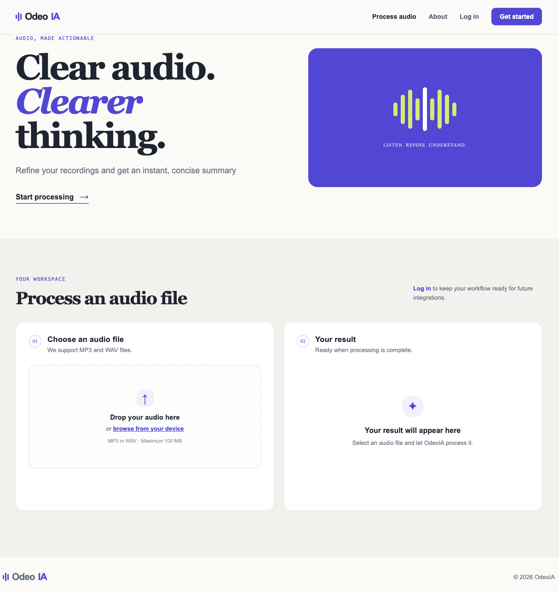
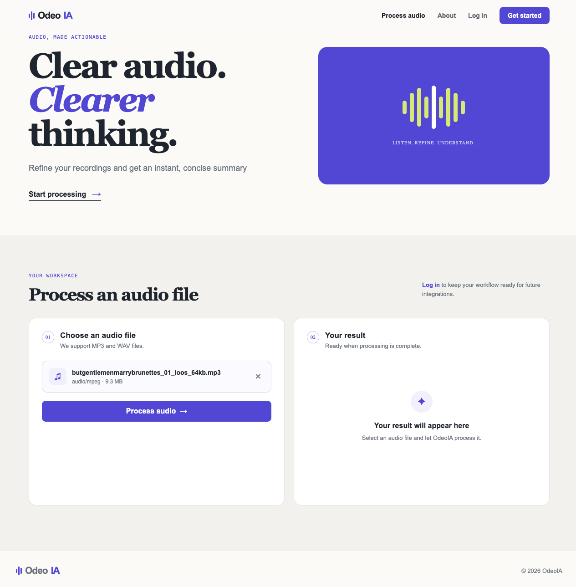
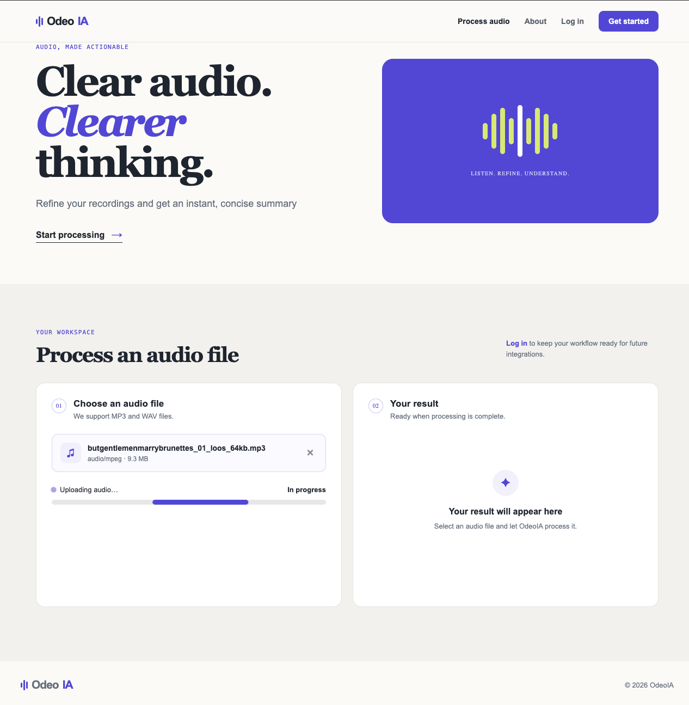
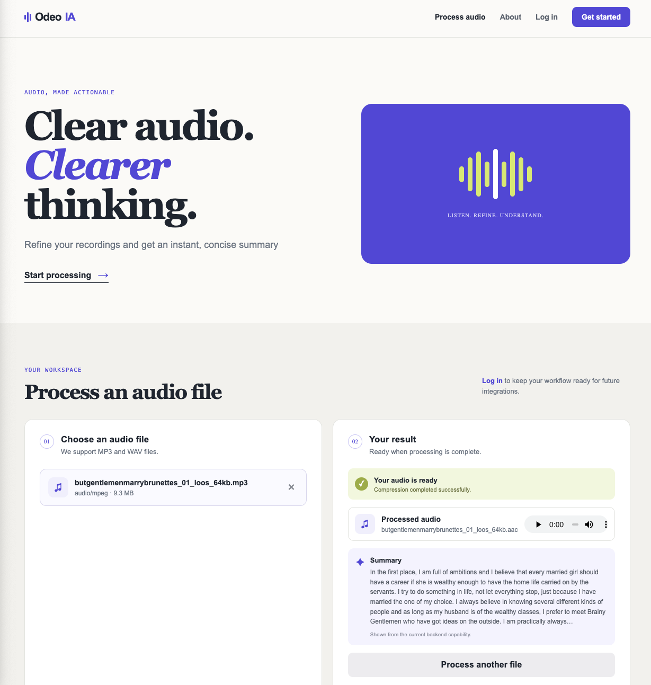

# Programming 7

## Lab Report: Lab #4

**Project Title:** OdeoIA - Audio Processor API  
**Student Name:** Oscar Steven Muñoz Fajardo  
**Student Email:** oscar.munoz@jala.university  
**Submission Date:** 02/08/2026  
**Instructor:** Leopoldo Flores

---

## 1. Introduction

**Overview:** En este laboratorio integré el frontend desarrollado con React con la API de OdeoIA, permitiendo realizar el flujo completo de procesamiento de audio desde la interfaz. El usuario puede seleccionar un archivo, enviarlo a la API, visualizar el estado del procesamiento y finalmente reproducir el audio comprimido.

**Target Objective:** El objetivo principal fue conectar la interfaz con el flujo asíncrono existente de OdeoIA, manteniendo una separación clara entre los componentes visuales y la comunicación con la API. También se configuró la integración para funcionar correctamente tanto en desarrollo local como mediante Docker y se agregaron validaciones para el frontend y GitLab CI.

---

# 2. Architecture & Implementation

La integración del frontend se realizó manteniendo separada la lógica de la interfaz y la comunicación con el backend. De esta manera, los componentes de React se concentran principalmente en representar la información y los diferentes estados del procesamiento.

## 2.1 Frontend Structure and Decoupling

El frontend se encuentra organizado en páginas, componentes reutilizables, layouts, estados y servicios. La comunicación HTTP se centralizó dentro de `audioService`, evitando distribuir llamadas mediante `fetch` directamente entre los componentes.

La navegación se implementó utilizando **React Router**, permitiendo cambiar entre las diferentes vistas sin recargar la aplicación. Actualmente, la autenticación permanece simulada en el frontend debido a que la API todavía no cuenta con endpoints para esta funcionalidad.

## 2.2 Asynchronous Audio Workflow

Cuando el usuario selecciona un archivo, el frontend lo envía mediante `multipart/form-data` al endpoint:

`POST /api/audio/upload`

La API almacena el archivo, registra el trabajo y responde con **HTTP 202 (Accepted)** mientras la compresión continúa ejecutándose de forma asíncrona.

Actualmente, el frontend consulta periódicamente `GET /api/audio/{id}` hasta obtener un estado **Completed** o **Failed**. Esta solución mediante polling es temporal; como mejora futura, la idea es utilizar **WebSockets** para que el backend pueda informar al frontend cuando el procesamiento finalice, evitando realizar consultas periódicas.

Cuando el proceso termina correctamente, se utiliza `compressedStorageUrl` para reproducir el audio procesado. Además, se utiliza `AbortController` para cancelar solicitudes pendientes cuando el usuario cambia de archivo o abandona la página.

## 2.3 Local and Docker Integration

Durante el desarrollo local, **Vite** redirige las solicitudes realizadas hacia `/api` al backend disponible en `http://localhost:5196`.

Cuando la aplicación se ejecuta mediante Docker, **Nginx** sirve el build de React y redirige estas mismas solicitudes al servicio `audio-processor-api:8080`. Esto permite mantener la misma ruta `/api` desde el frontend independientemente del entorno donde se ejecute la aplicación.

## 2.4 Validation and CI

El **Makefile** incluye validaciones separadas para frontend y backend. Para React se utilizan **ESLint** y el build de producción de **Vite**.

También se actualizó el hook de **pre-push** para ejecutar únicamente las validaciones necesarias dependiendo de los archivos modificados. En **GitLab CI** se utiliza una estrategia similar mediante `rules:changes`, evitando ejecutar jobs que no están relacionados con los cambios realizados.

---

## 3. Pull Request (PR)

* **Pull Request Link:** `[Insert GitLab Pull Request URL here]`

---

## 4. Benchmark & Performance Measurements (If Applicable) 
*If required by the lab specifications, document your execution performance analysis to verify your optimization achieves computational efficiency.*

Following table is just an example (you can customize it):

| Execution Strategy | Dataset / Load Profile Details | Execution Time (ms) | Resource Metrics (CPU % / RAM MB) |
| :--- | :--- | :--- | :--- |
| **Sequential / Baseline** | [e.g., Unoptimized or sequential loop iteration] | `0000 ms` | `00% CPU / 000MB` |
| **Optimized (Async/Parallel/Threads)** | [e.g., Concurrent execution or multi-core distribution] | `0000 ms` | `00% CPU / 000MB` |

**Performance Analysis:**
> [Interpret the raw data. Analyze the results. Explain *why*.]

---

# 5. Execution Results & Empirical Evidence

Las siguientes evidencias muestran el flujo completo desde que el usuario selecciona un archivo hasta que el audio procesado queda disponible.

## 5.1 User Interface Workflow

### Audio Selection

El usuario selecciona desde la interfaz el archivo de audio que desea procesar.

### Audio Upload and Processing

Después de enviar el archivo, la interfaz muestra que el audio se encuentra siendo procesado de forma asíncrona por el backend.

### Processing Status

Mientras el procesamiento continúa, el frontend consulta temporalmente el estado del trabajo mediante la API.

### Processed Audio Result

Finalmente, cuando el procesamiento termina, el frontend utiliza la URL proporcionada por la API para reproducir el audio comprimido.

---

# 6. Self Assessment & Reflection

Durante este laboratorio pude aplicar varios conocimientos adquiridos en cursos anteriores para mantener buenas prácticas durante el desarrollo del frontend con React. Intenté mantener los componentes separados, evitar mezclar la comunicación con la API directamente con la interfaz y organizar el proyecto de una forma que facilite futuros cambios.

También pude entender mejor cómo integrar un frontend con un backend que trabaja de forma asíncrona y cómo manejar los diferentes estados del procesamiento desde la perspectiva del usuario.

Considero que todavía me falta bastante por aprender sobre React y desarrollo frontend, pero comparando con proyectos anteriores siento que he avanzado en la forma de estructurar los componentes, separar responsabilidades y pensar en la mantenibilidad del código.

---

## 7. Conclusions

Considero que este laboratorio permitió completar una parte importante de OdeoIA al conectar la interfaz con el flujo real de procesamiento de audio. Además, pude aplicar conceptos aprendidos anteriormente tanto en la organización del frontend como en su integración con el backend.

Todavía existen varias mejoras para futuras versiones. Una de las principales es reemplazar el polling actual por **WebSockets**, permitiendo recibir actualizaciones del procesamiento en tiempo real. También se puede integrar autenticación cuando la API proporcione los endpoints necesarios y continuar mejorando la experiencia de usuario a medida que se agreguen nuevas funcionalidades al proyecto.
