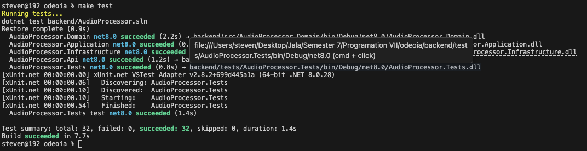
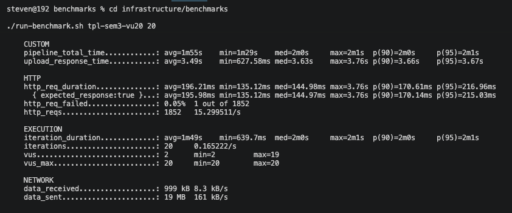
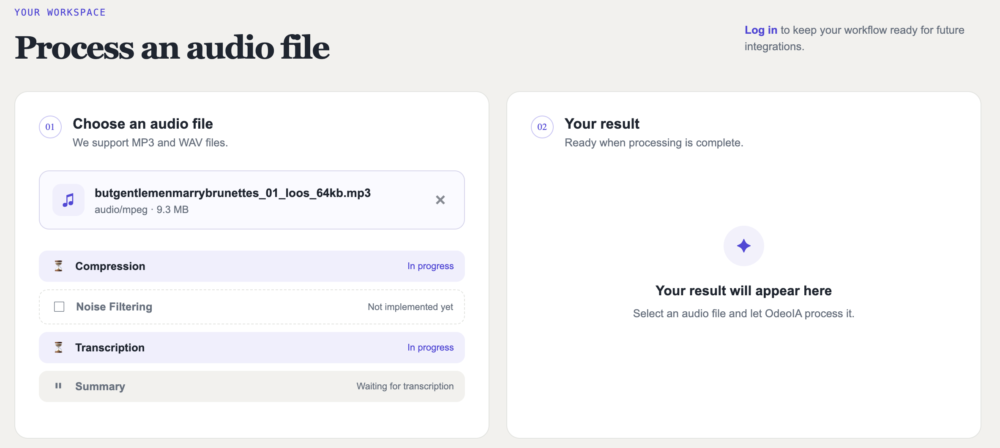
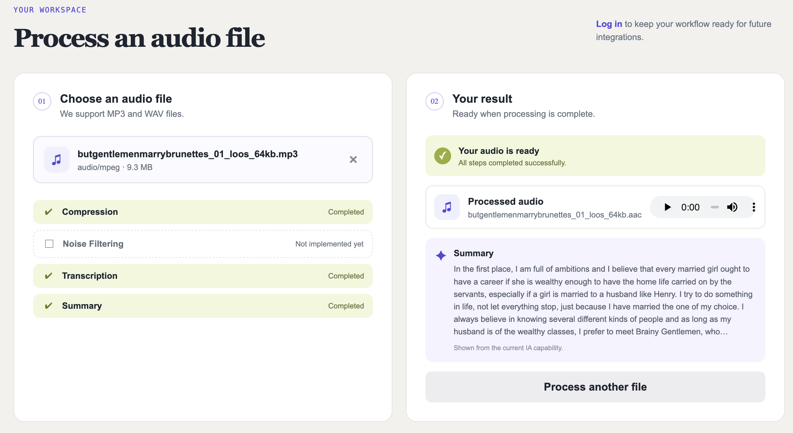
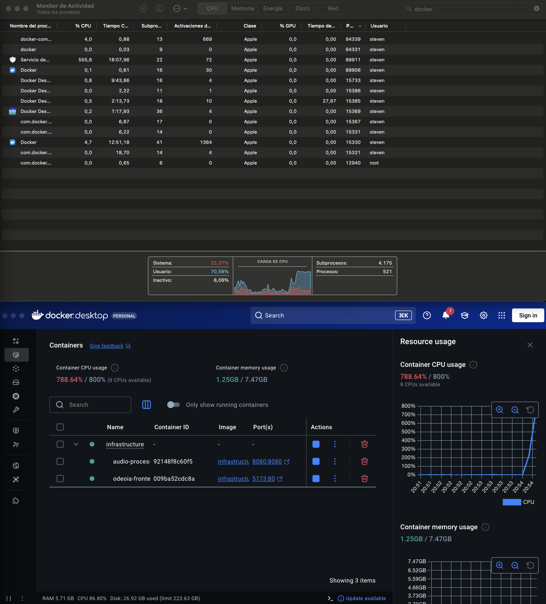

# Programming 7

## Lab Report: Lab #5

**Project Title:** OdeoIA - Audio Processor API  
**Student Name:** Oscar Steven Muñoz Fajardo  
**Student Email:** oscar.munoz@jala.university  
**Submission Date:** 09/08/2026  
**Instructor:** Leopoldo Flores

---

## 1. Introduction

**Overview:** En este laboratorio actualicé la forma en que el backend de OdeoIA procesa los audios de manera concurrente. La implementación anterior utilizaba un hilo independiente para cada flujo de procesamiento (compresión y generación del resumen). En esta versión migré esa lógica a la Task Parallel Library (TPL) de C#, utilizando `Task.Run` y `Task.WhenAll` para ejecutar ambos procesos de forma paralela.

Durante esta migración también fue necesario ajustar la sincronización de los procesos externos. Para ello reemplacé las esperas bloqueantes por esperas asíncronas, permitiendo que la aplicación aproveche mejor sus recursos mientras espera a que finalicen tareas como la compresión, la transcripción o la generación del resumen.

**Target Objective:** Los objetivos de este laboratorio fueron tres. Primero, migrar el procesamiento concurrente de audio para utilizar la Task Parallel Library de C#. Segundo, adaptar los mecanismos de sincronización necesarios para que esta nueva implementación funcionara correctamente. Por último, verificar que cada audio procesado continuara mostrando su resumen desde la aplicación sin afectar el funcionamiento existente.

---

## 2. Architecture & Implementation

### 2.1 De `Thread` a `Task`

El cambio principal de este laboratorio fue reemplazar el uso de `Thread` por la Task Parallel Library (TPL) de C#. Antes, cada audio creaba un hilo independiente para ejecutar la compresión y otro para generar el resumen. Con esta implementación ambos procesos se ejecutan como tareas utilizando `Task.Run`, y la aplicación espera a que los dos finalicen mediante `Task.WhenAll`.

Este cambio hizo que el código fuera más sencillo de mantener y aprovechara mejor los recursos disponibles, ya que TPL administra las tareas de forma más eficiente que crear un hilo nuevo para cada proceso.

Mientras realizaba esta migración también optimicé la descarga del audio. Anteriormente cada flujo descargaba el mismo archivo por separado, lo que generaba solicitudes repetidas al almacenamiento. Ahora el audio se descarga una sola vez y ambos procesos reutilizan esa información, reduciendo el tráfico innecesario y mejorando el tiempo de procesamiento.

Además, ajusté el manejo de errores para asegurar que cualquier excepción quedara registrada sin afectar el resto del procesamiento. De esta manera, si uno de los flujos presenta un problema, la aplicación continúa funcionando y es posible identificar la causa mediante los registros.

### 2.2 Sincronización de procesos

Después de migrar a TPL también fue necesario actualizar la forma en que la aplicación espera la ejecución de los procesos externos, como la compresión del audio, la transcripción y la generación del resumen.

Antes estas esperas bloqueaban la ejecución hasta que el proceso terminaba. Ahora se realizan de forma asíncrona, permitiendo que la aplicación continúe atendiendo otras tareas mientras espera el resultado. Esto mejora el uso de los recursos y hace que el procesamiento concurrente sea más eficiente.

Otra mejora fue hacer configurable el límite de procesos que pueden ejecutarse al mismo tiempo. En lugar de dejar este valor fijo en el código, ahora puede definirse mediante una variable de entorno, lo que facilita realizar pruebas con diferentes configuraciones sin necesidad de modificar la aplicación.

### 2.3 Resumen por cada audio

Uno de los objetivos del laboratorio era que cada audio procesado mostrara su resumen desde la interfaz. Esto ya lo habia hecho en el laboratorio anterior, por lo que el frontend no se vio afectado. Aqui lo que habia hecho era que una vez el frontend identificaba que el audio ya habia sido procesado mediante el polling, descagarba el resumen através de la url que la respuesta devolvia y lo mostraba en la interfaz.

---

## 3. Pull Request (PR)

- **Pull Request Link:** https://gitlab.com/jala-university1/cohort-2/ES.CSPR-471.GA.T2.26.M1/SB/oscar.munoz/odeoia/-/merge_requests/6

---

## 4. Benchmark & Performance Measurements

### 4.1 Primera ronda de pruebas

En la primera ronda evalué el comportamiento de ambas implementaciones con hasta 10 usuarios concurrentes (VU 1, 2, 5, 10) y 1, 2, 3, 4 procesos en el semáforo. En este escenario los resultados fueron muy similares y la configuración con un límite de 3 procesos en el semáforo fue el que ofreció el mejor equilibrio entre rendimiento y estabilidad.

Durante estas pruebas apareció un comportamiento inesperado en una de las ejecuciones con TPL y un límite de 4 procesos. Como los resultados no coincidían con lo esperado, decidí repetir las pruebas antes de asumir que existía un problema en la implementación.

### 4.2 Segunda ronda de pruebas

La segunda ronda aumenté la carga hasta **20 usuarios concurrentes**. En esta ocasión la anomalía observada anteriormente no volvió a aparecer, por lo que concluí que se trataba de un comportamiento aislado y no de un problema de la implementación.

Con esta carga fue donde realmente aparecieron las diferencias entre ambas soluciones.

#### Resultados del procesamiento (VU = 20)

| Implementación        |      Pipeline completado      |
| --------------------- | :---------------------------: |
| Threads - Semaphore 3 | **4/17** (+3 cargas fallidas) |
| Threads - Semaphore 4 |           **5/20**            |
| TPL - Semaphore 3     |           **20/20**           |
| TPL - Semaphore 4     |           **20/20**           |

Mientras la implementación basada en `Thread` comenzó a rechazar solicitudes y no logró completar la mayoría de los procesos, TPL procesó correctamente el 100 % de los audios en ambos escenarios.

### 4.3 Consumo de recursos

Además de medir los tiempos de respuesta, también analicé el consumo de CPU y memoria durante cada prueba.

| Implementación        | CPU promedio | Memoria promedio | Resultado |
| --------------------- | -----------: | ---------------: | --------- |
| Threads - Semaphore 3 |      356.5 % |         1014 MiB | 4/17      |
| Threads - Semaphore 4 |      349.0 % |         1017 MiB | 5/20      |
| TPL - Semaphore 3     |  **508.6 %** |         1143 MiB | **20/20** |
| TPL - Semaphore 4     |      582.7 % |         1214 MiB | **20/20** |

Aunque TPL utilizó más CPU que la implementación con `Thread`, también fue la única capaz de completar todas las solicitudes. Esto indica que el problema no estaba en la falta de recursos, sino en la forma en que cada modelo administra el trabajo cuando aumenta la concurrencia.

### 4.4 Análisis de resultados

Las pruebas mostraron que, con pocos usuarios concurrentes, ambas implementaciones ofrecen un comportamiento similar. Sin embargo, al aumentar la carga, TPL mantiene una ejecución mucho más estable y logra completar todas las solicitudes, mientras que la implementación basada en `Thread` comienza a degradarse e incluso rechaza algunas peticiones.

Entre las dos configuraciones evaluadas para TPL, ambas alcanzaron un **20/20** en las pruebas de mayor carga. No obstante, **TPL con un límite de 3 procesos concurrentes** presentó un menor consumo de CPU que la configuración con 4 procesos, manteniendo el mismo nivel de confiabilidad. Por esta razón considero que es la mejor opción para este proyecto, ya que ofrece el mejor equilibrio entre rendimiento, estabilidad y uso de recursos.

---

## 5. Execution Results & Empirical Evidence

**Prueba unitaria exitosa**

Aquí se puede observar que después de la migración a TPL, todas las pruebas del proyecto se ejecutan correctamente y no se introdujeron errores en el backend.

---

**Procesamiento concurrente con TPL**

Aqui se puede observar que la aplicación procesa correctamente todas las solicitudes bajo carga utilizando la implementación basada en TPL.

---

**Resumen generado en la aplicación**

Aqui se puede observar que una vez finalizado el procesamiento, se muestra correctamente el resumen asociado a cada audio.

---

**Monitoreo de recursos durante el benchmark**

Aquí se puede observar el consumo de CPU y memoria mientras se ejecutan las pruebas de concurrencia.

## 6. Self-Assessment, Blockers & Bugs

**Technical Challenges & Bugs encountered:**

Durante la migración el principal reto fue adaptar el procesamiento basado en `Thread` a TPL sin modificar el comportamiento de la aplicación. Aunque ambos modelos permiten ejecutar tareas de forma concurrente, su manejo de errores es diferente, por lo que tuve que ajustar la forma en que se registraban las excepciones para asegurar que cualquier fallo quedara registrado sin afectar el resto del procesamiento.

Otro desafío apareció durante las primeras pruebas de rendimiento. Una de las configuraciones mostró tiempos de ejecución mucho mayores a los esperados, pero antes de asumir que existía un problema en la implementación decidí repetir los experimentos bajo las mismas condiciones. Después de realizar una segunda ronda de pruebas comprobé que el comportamiento no volvía a presentarse, por lo que concluí que se trataba de un resultado aislado y no de un error del código.

Finalmente, durante la ejecución de los benchmarks una de las pruebas se interrumpió de forma inesperada y no generó resultados válidos. En lugar de utilizar esos datos, decidí descartarlos y continuar el análisis únicamente con las ejecuciones que pudieron completarse correctamente.

**Resolution Strategy:** Para la garantía de excepciones, usé un test dedicado (`AudioProcessingLauncherTests`) que fuerza un fallo antes de que se ejecute el `try/catch` interno del handler, y verifica que igual queda logueado sin tumbar el proceso — el equivalente, adaptado a `Task`, del test que antes verificaba lo mismo para `Thread`. Para la anomalía de `tpl-sem4`, la estrategia fue puramente empírica: no especular sobre la causa sin datos, sino diseñar una corrida controlada (misma configuración, sesión distinta) que permitiera confirmar o descartar el patrón — y reportar el resultado con la misma honestidad tanto si confirmaba como si refutaba la hipótesis inicial.

---

## 7. Conclusions

Este laboratorio me permitió comprobar que migrar de `Thread` a la Task Parallel Library no solo simplifica la implementación, sino que también mejora el comportamiento de la aplicación cuando aumenta la concurrencia. Aunque con pocos usuarios ambas soluciones ofrecen resultados similares, las pruebas demostraron que TPL mantiene un procesamiento mucho más estable cuando la carga es mayor.

Otro aspecto importante fue el proceso de validación. En lugar de quedarme con los resultados de una sola prueba, repetí los experimentos cuando encontré comportamientos inesperados y utilicé los nuevos datos para confirmar o descartar mis hipótesis. Esto me permitió llegar a conclusiones más confiables y respaldadas por evidencia.

Finalmente, la herramienta de benchmarking desarrollada para este laboratorio resultó ser un aporte importante al proyecto. Además de automatizar las pruebas de concurrencia, facilitó la recolección de métricas de rendimiento y consumo de recursos, haciendo posible comparar objetivamente ambas implementaciones.

---

## 8. Recommendations

Como resultado de las pruebas realizadas, considero que la mejor configuración para este proyecto es utilizar **TPL** con un límite de **3 procesos concurrentes**, ya que fue la opción que ofreció el mejor equilibrio entre estabilidad, rendimiento y consumo de recursos.

También recomiendo automatizar este tipo de pruebas desde las primeras etapas del desarrollo. Herramientas como **k6** permiten ejecutar escenarios de carga de forma repetible y obtener métricas que facilitan la toma de decisiones basadas en evidencia, en lugar de depender únicamente de pruebas manuales.

Por último, sería interesante ampliar este trabajo evaluando cargas aún mayores y agregando nuevas métricas relacionadas con el uso de hilos, tiempos de espera y comportamiento del sistema bajo diferentes configuraciones. Esto permitiría entender con mayor detalle cómo escala la aplicación a medida que aumenta la demanda.
