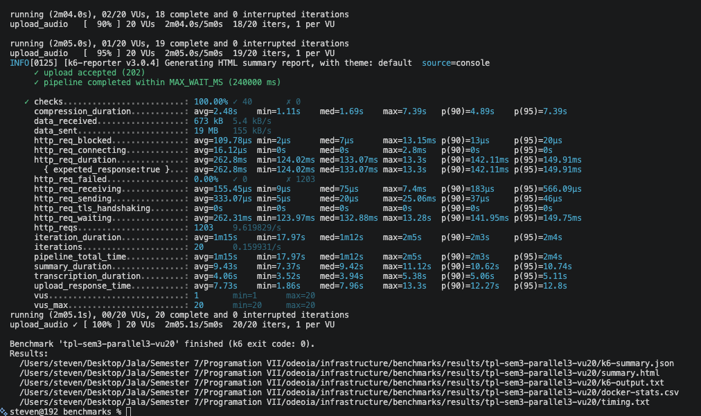
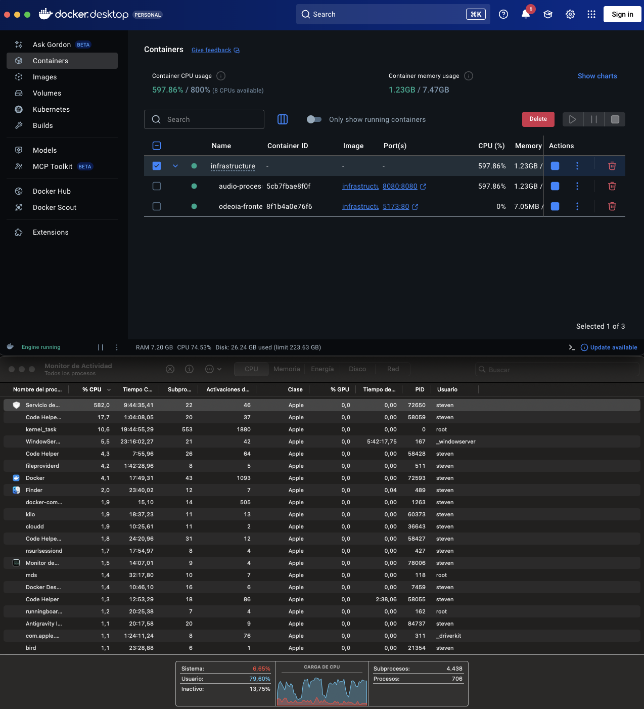
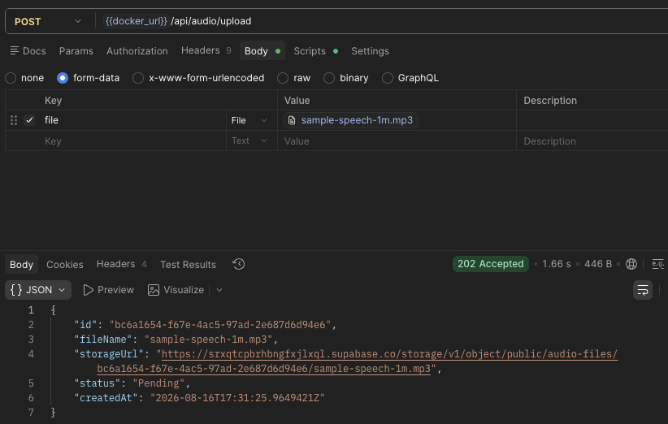
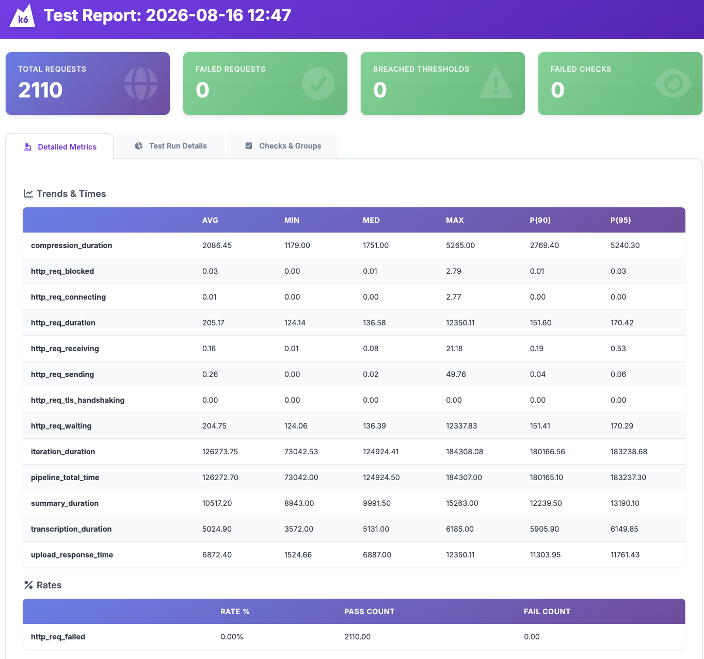
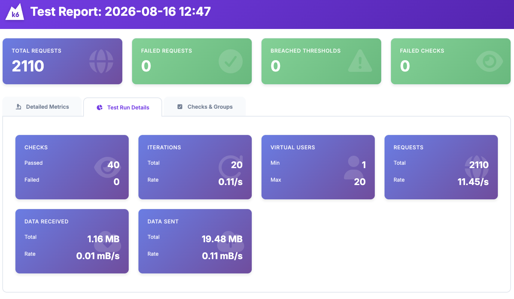
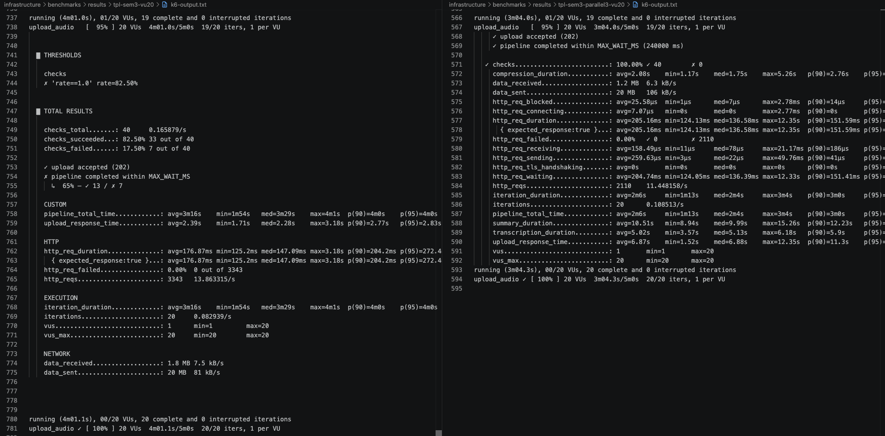
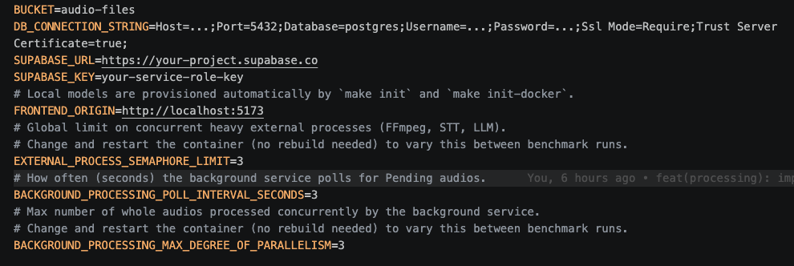

# Programming 7

## Lab Report: Lab #6

**Project Title:** OdeoIA - Audio Processor API  
**Student Name:** Oscar Steven Muñoz Fajardo  
**Student Email:** oscar.munoz@jala.university  
**Submission Date:** 16/08/2026  
**Instructor:** Leopoldo Flores

---

## 1. Introduction

**Overview**

En este laboratorio continué mejorando el procesamiento de audios de la API de OdeoIA. En el laboratorio anterior ya había migrado parte del procesamiento de `Thread` a la Task Parallel Library (TPL), permitiendo ejecutar en paralelo los diferentes procesos de un mismo audio.

En esta ocasión el objetivo fue llevar ese control un paso más adelante. En lugar de procesar cada audio inmediatamente después de recibirlo, implementé un procesamiento en segundo plano que permite controlar cuántos audios completos pueden procesarse al mismo tiempo. Para esto utilicé `Parallel.ForEachAsync` junto con `MaxDegreeOfParallelism`.

Con este cambio, cuando un usuario sube un audio, la API lo guarda como pendiente y responde inmediatamente. Luego, un servicio en segundo plano se encarga de tomar los audios pendientes y procesarlos de acuerdo con el límite configurado. Esto permite controlar mejor la cantidad de trabajo que se ejecuta al mismo tiempo y evitar una sobrecarga cuando aumenta el número de usuarios.

También realicé nuevas pruebas de carga para comparar el comportamiento **antes y después de este cambio**. Durante estas pruebas medí los tiempos de procesamiento y el consumo de CPU y memoria, con el objetivo de encontrar una configuración que permitiera aumentar el número de usuarios concurrentes sin afectar la estabilidad de la aplicación.

**Target Objective:**

Los objetivos principales de este laboratorio fueron:

* Implementar el procesamiento de audios en segundo plano.
* Utilizar `Parallel.ForEachAsync` para controlar la cantidad de audios procesados simultáneamente.
* Comparar el número de usuarios concurrentes que puede soportar la aplicación antes y después del cambio.
* Analizar los tiempos de procesamiento y el consumo de recursos durante las pruebas.
* Encontrar una configuración que permita mejorar el rendimiento sin sobrecargar la aplicación.

---

## 2. Architecture & Implementation

### 2.1 Procesamiento en segundo plano con `BackgroundService`

El cambio principal fue separar la recepción del audio de su procesamiento. Antes, cuando un usuario subía un archivo, el procesamiento comenzaba inmediatamente. Ahora, la API primero guarda el audio como `Pending` y responde al usuario, mientras que un servicio en segundo plano se encarga de procesarlo posteriormente. 

Para esto agregué un `BackgroundService` que revisa periódicamente los audios pendientes. Cada vez que se ejecuta, busca los audios que todavía no han sido procesados, los marca como `Processing` y luego los envía al procesamiento. Marcar el audio antes de comenzar evita que vuelva a ser tomado en la siguiente revisión. 

El procesamiento de estos audios se realiza utilizando `Parallel.ForEachAsync`. La cantidad de audios que pueden procesarse al mismo tiempo se controla mediante `MaxDegreeOfParallelism`, cuyo valor se puede configurar mediante una variable de entorno. De esta forma puedo aumentar o reducir la cantidad de trabajo simultáneo sin tener que modificar el código. 

También tuve que cambiar la forma en que se iniciaba el procesamiento. Antes se lanzaba el trabajo y el método terminaba inmediatamente, sin esperar a que el procesamiento finalizara. Para utilizar correctamente `Parallel.ForEachAsync`, ahora cada tarea espera hasta que termina el procesamiento completo del audio. Esto permite que el límite configurado realmente controle cuántos audios están siendo procesados al mismo tiempo. 

Con estos cambios ahora existen **tres niveles de control**:

* `Parallel.ForEachAsync`: controla cuántos **audios completos** se procesan al mismo tiempo.
* `Task.Run` y `Task.WhenAll`: permiten ejecutar en paralelo los **dos flujos de un mismo audio**.
* `SemaphoreSlim`: limita la cantidad de **procesos pesados** que pueden ejecutarse al mismo tiempo.

Cada uno controla una parte diferente del procesamiento, por lo que no cumplen exactamente la misma función. 

### 2.2 Investigación del problema bajo carga

Antes de cambiar la configuración, quise entender por qué la aplicación comenzaba a fallar cuando aumentaba la cantidad de usuarios. Para esto repetí el escenario que había mostrado problemas con **20 usuarios concurrentes** y observé directamente qué estaba sucediendo dentro del contenedor. 

Primero revisé cuántos hilos utilizaban los procesos de transcripción y generación del resumen. Encontré que `whisper-cli` y `llama-cli` ya estaban configurados para utilizar 2 hilos cada uno, mientras que `ffmpeg` no tenía un límite definido. 

Durante la prueba llegué a observar hasta **4 procesos pesados ejecutándose al mismo tiempo**. En algunos momentos había 4 procesos de `whisper-cli`, cada uno utilizando 2 hilos, lo que significaba que solo esos procesos podían utilizar los 8 núcleos disponibles en el equipo. Esto ocurría antes de considerar el consumo del resto de la aplicación. 

También medí el consumo de recursos con `docker stats`. La aplicación llegó a alcanzar un pico de **1229.85 % de CPU**, mientras que la memoria se mantuvo por debajo del **18.29 %** del límite disponible. Esto me permitió concluir que el problema principal no estaba relacionado con la memoria, sino con la cantidad de trabajo que estaba intentando ejecutar al mismo tiempo. 

A partir de estas mediciones y de los resultados obtenidos en los benchmarks, decidí reducir de **4 a 3** tanto el límite de `SemaphoreSlim` como el de `MaxDegreeOfParallelism`. 

---

## 3. Pull Request (PR)

- **Pull Request Link:** https://gitlab.com/jala-university1/cohort-2/ES.CSPR-471.GA.T2.26.M1/SB/oscar.munoz/odeoia/-/merge_requests/7

---

# 4. Benchmark & Performance Measurements

### 4.1 Comparación antes y después

Para evaluar el efecto de `Parallel.ForEachAsync`, comparé cuatro corridas de la implementación anterior con seis corridas de la nueva implementación. Todas las pruebas utilizaron el mismo tiempo máximo de espera de **240 segundos**.

Durante estas pruebas también encontré un problema con las solicitudes concurrentes hacia Supabase. En algunas ocasiones los headers se sobrescribían y podían quedar en `null`, provocando que la solicitud no se ejecutara correctamente. Para reducir este problema agregué un `SemaphoreSlim(1,1)` alrededor de las solicitudes a Supabase. Después de este cambio, el problema ocurrió con mucha menos frecuencia.

Además de los tiempos, tuve en cuenta dos posibles fallos: que el upload no respondiera con `202` y que el procesamiento superara los 240 segundos.

### 4.2 Comparación de tiempos

| Configuración              | Usuarios | Pipeline avg |         p95 | Completados |
| -------------------------- | -------: | -----------: | ----------: | ----------: |
| Sin Parallel + Semaphore 3 |       10 |       99.4 s |     126.6 s |       10/10 |
| Sin Parallel + Semaphore 3 |       20 |      196.0 s |     240.8 s |   **13/20** |
| Sin Parallel + Semaphore 4 |       10 |      108.1 s |     135.0 s |       10/10 |
| Sin Parallel + Semaphore 4 |       20 |      192.3 s |     241.2 s |   **10/20** |
| Parallel 3 + Semaphore 3   |       10 |   **79.6 s** |     117.8 s |   **10/10** |
| Parallel 3 + Semaphore 3   |       20 |  **137.6 s** | **219.4 s** |   **20/20** |
| Parallel 4 + Semaphore 3   |       10 |       76.8 s |     113.3 s |       10/10 |
| Parallel 4 + Semaphore 3   |       20 |      142.8 s |     237.3 s |   **20/20** |
| Parallel 4 + Semaphore 4   |       10 |       80.8 s |     114.8 s |       10/10 |
| Parallel 4 + Semaphore 4   |       20 |      146.2 s |     236.6 s |   **20/20** |

Con 20 usuarios concurrentes se observa la principal diferencia. La implementación anterior solo completó **13/20** procesos con `SemaphoreSlim=3` y **10/20** con `SemaphoreSlim=4`. Después de agregar `Parallel.ForEachAsync`, las tres configuraciones probadas completaron **20/20**.

Los tiempos de la línea base con 20 usuarios también están afectados por los procesos que llegaron al límite de 240 segundos, por lo que en estos casos el porcentaje de procesos completados es más representativo que el promedio.

### 4.3 Consumo de recursos

| Configuración              | Usuarios |    CPU avg | CPU max |  Memoria avg |
| -------------------------- | -------: | ---------: | ------: | -----------: |
| Sin Parallel + Semaphore 3 |       20 |     555.9% | 1257.6% |     1138 MiB |
| Sin Parallel + Semaphore 4 |       20 |     669.8% |  878.2% |     1257 MiB |
| Parallel 3 + Semaphore 3   |       20 | **438.4%** |  724.0% | **1035 MiB** |
| Parallel 4 + Semaphore 3   |       20 |     486.3% |  690.9% |     1072 MiB |
| Parallel 4 + Semaphore 4   |       20 |     576.3% |  977.4% |     1175 MiB |

La configuración `Parallel 3 + Semaphore 3` también presentó el menor consumo promedio de CPU y memoria entre las configuraciones evaluadas con `Parallel`.

Sin embargo, esto no significa que utilizar menos CPU sea siempre mejor. El objetivo es encontrar un equilibrio entre **cantidad de procesos, tiempo de respuesta y recursos disponibles**. Si en el futuro se utiliza un servidor con más recursos, sería necesario repetir las pruebas y ajustar estos valores.

### 4.4 Tiempo por etapa

| Configuración                   | Compresión | Transcripción | Summary |
| ------------------------------- | ---------: | ------------: | ------: |
| Parallel 3 + Semaphore 3 — VU20 |      3.4 s |         8.4 s |  19.2 s |
| Parallel 4 + Semaphore 3 — VU20 |      9.9 s |        13.6 s |  25.8 s |
| Parallel 4 + Semaphore 4 — VU20 |      5.4 s |        11.6 s |  25.9 s |

El desglose muestra que aumentar el paralelismo de 3 a 4 no hizo que cada audio terminara más rápido. Al contrario, las etapas de compresión, transcripción y generación del resumen tardaron más, probablemente porque había más procesos compitiendo por los mismos recursos.

### 4.5 Resultado

A partir de los resultados, la configuración que considero más adecuada para el entorno probado es:

**`MaxDegreeOfParallelism=3` + `SemaphoreSlim=3`**

Fue la configuración que logró **20/20 procesos completados con 20 usuarios**, obtuvo el menor `p95` y el menor consumo promedio de CPU y memoria entre las configuraciones con `Parallel`.

La principal mejora de esta implementación no fue solamente reducir el tiempo de procesamiento, sino **controlar mejor cuántos audios se procesan al mismo tiempo**. Esto permitió pasar de un máximo de **65 % de procesos completados** en la implementación anterior a **100 %** con `Parallel.ForEachAsync` bajo la carga de 20 usuarios.

---

# 5. Execution Results & Empirical Evidence

### 5.1 Prueba de carga con k6

Para realizar las pruebas utilicé un script de **k6** que me permitió simular diferentes cantidades de usuarios concurrentes y registrar los resultados de cada ejecución. Inicialmente había realizado algunas pruebas manuales con Postman, pero necesitaba una forma más completa de repetir las pruebas y recopilar las métricas de tiempo y consumo de recursos.

### 5.2 Consumo de recursos

Durante las pruebas también revisé el consumo de los contenedores utilizando Docker. Esto me permitió observar cómo cambiaba el uso de CPU y memoria mientras aumentaba la cantidad de usuarios.

### 5.3 Procesamiento en segundo plano

Aquí se puede observar que la aplicación recibe el audio y responde sin tener que esperar a que termine todo el procesamiento. El audio queda pendiente para ser procesado posteriormente en segundo plano.

### 5.4 Resultado con 20 usuarios

Aquí se puede observar el resultado de la configuración seleccionada con 20 usuarios concurrentes. La prueba logró completar correctamente todos los procesos que llegaron al pipeline.

### 5.6 Comparación antes y después

Aquí se puede observar la diferencia entre la implementación anterior y la nueva implementación utilizando `Parallel.ForEachAsync`. Con 20 usuarios, la versión anterior no lograba completar todas las solicitudes, mientras que la nueva configuración consiguió completar el 100 % de los procesos.

**Sin parallel vs con parallel**

### 5.7 Configuración utilizada

Aquí se puede observar la configuración utilizada para controlar la cantidad de procesos que pueden ejecutarse simultáneamente. Para las pruebas finales utilicé `MaxDegreeOfParallelism=3` y `SemaphoreSlim=3`.

---

## 6. Self-Assessment, Blockers & Bugs

Durante la implementación encontré un problema importante al trabajar con `Parallel.ForEachAsync`. Al principio, el método que iniciaba el procesamiento no esperaba a que terminara realmente el audio, por lo que `Parallel.ForEachAsync` podía considerar que una tarea ya había terminado cuando el procesamiento todavía continuaba.

Para solucionarlo cambié el procesamiento para que pudiera ser esperado correctamente mediante `await`. De esta forma, el límite configurado en `Parallel.ForEachAsync` realmente controla cuántos audios están siendo procesados al mismo tiempo.

También encontré un problema con las solicitudes concurrentes hacia Supabase. En algunas pruebas, los headers podían sobrescribirse y quedar en `null`, provocando fallos en el upload. Para reducir este comportamiento agregué un `SemaphoreSlim(1,1)` alrededor de las solicitudes a Supabase. Esto hizo que el problema apareciera con mucha menos frecuencia.

Finalmente, aprendí que para evaluar este tipo de cambios no es suficiente con mirar únicamente el tiempo total del pipeline. Al medir cada etapa por separado pude entender mejor qué estaba pasando y por qué una configuración con menos procesos simultáneos podía obtener mejores resultados.

---

# 7. Conclusions

Este laboratorio me permitió comprobar que agregar más paralelismo no significa necesariamente obtener un mejor resultado.

Con `Parallel.ForEachAsync` pude mejorar el comportamiento de la API cuando aumentó la cantidad de usuarios concurrentes. Con 20 usuarios, la implementación anterior solo consiguió completar entre **50 % y 65 %** de los procesos, mientras que las configuraciones con `Parallel` alcanzaron el **100 %**.

También pude comprobar que aumentar `MaxDegreeOfParallelism` de 3 a 4 no produjo una mejora. En las pruebas realizadas, `parallel3` consiguió mejores tiempos y utilizó menos recursos que `parallel4`.

Por esto, considero que el punto más importante que aprendí es que **el objetivo no es ejecutar la mayor cantidad de tareas posibles al mismo tiempo, sino encontrar un punto donde la aplicación pueda procesar más usuarios sin generar demasiada competencia por los recursos disponibles.**

---

# 8. Recommendations

Para las condiciones en las que realicé las pruebas, recomiendo utilizar:

**`SemaphoreSlim=3` + `MaxDegreeOfParallelism=3`**

Esta configuración logró completar el **100 % de los procesos con 20 usuarios concurrentes**, además de presentar los mejores resultados generales de tiempo y consumo de recursos entre las configuraciones evaluadas.

Estos valores no deberían considerarse definitivos para cualquier servidor. Si la aplicación se despliega posteriormente en una máquina con más recursos, sería recomendable repetir las pruebas con diferentes valores de paralelismo para comprobar si es posible aumentar la cantidad de procesos simultáneos.

También recomiendo revisar y corregir definitivamente el problema encontrado con Supabase antes de realizar pruebas de carga mucho mayores, ya que un fallo en el upload puede afectar los resultados aunque el procesamiento de audio esté funcionando correctamente.

Como siguiente prueba, sería interesante aumentar la carga a **30 o 40 usuarios concurrentes** y comprobar si `Parallel=3` continúa siendo la mejor configuración o si, al disponer de más recursos, resulta conveniente aumentar el nivel de paralelismo.
