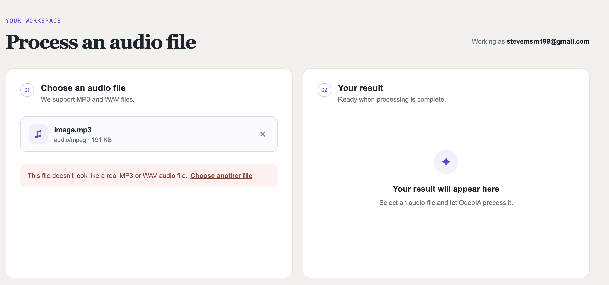
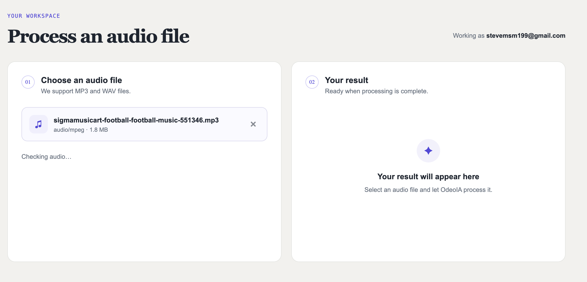
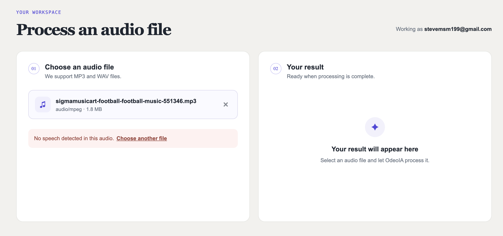
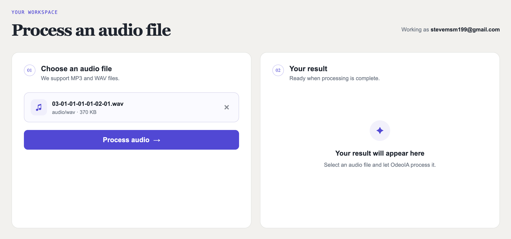
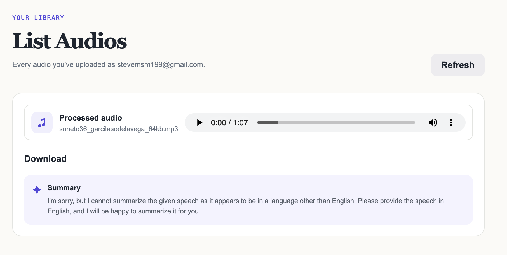

# Programming 7
## Lab Report: Lab #7

**Project Title:** OdeoIA - Audio Processor API  
**Student Name:** Oscar Steven Muñoz Fajardo  
**Student Email:** oscar.munoz@jala.university  
**Submission Date:** 23/08/2026  
**Instructor:** Leopoldo Flores  

---

## 1. Introduction

* **Overview:** En este ciclo de laboratorio implementé la validación de archivos de audio en el lado del cliente utilizando programación paralela en el frontend mediante **Web Workers** y modelos de Machine Learning en el navegador (`@huggingface/transformers`). Además, extendí la arquitectura para asociar los audios procesados al correo electrónico del usuario autenticado y construí una nueva sección ("List Audios") en la interfaz para consultar, reproducir y descargar el historial de audios con sus respectivos resúmenes generados.
* **Target Objective:** Cumplir con los objetivos de la Semana 7 (Programación Paralela en el cliente): restringir y validar archivos de audio antes de subirlos al servidor para evitar procesamientos innecesarios, delegar tareas computacionalmente pesadas fuera del hilo principal de la interfaz para evitar bloqueos del UI Event Loop mediante Web Workers y objetos transferibles (`Transferable Objects`), e incorporar la consulta histórica de audios vinculados al usuario.

---

## 2. Architecture & Implementation - This area is entirely yours

### 2.1 Pipeline de validación de audio en el cliente

Para evitar que el usuario suba archivos corruptos, archivos que no sean audios reales (como un `.zip` renombrado a `.mp3`) o audios que contengan únicamente música/ruido sin voz, diseñé un flujo de validación en varias etapas antes de habilitar la subida al servidor:

1. **Inspección de firmas binarias (Magic Numbers):** Mediante `sniffAudioSignature`, inspecciono los primeros 12 bytes del archivo (`RIFF`/`WAVE` para WAV, `ID3` o sincronización de tramas `0xFF` para MP3). Si el encabezado no coincide con una firma válida de audio, el archivo se rechaza inmediatamente sin necesidad de decodificarlo.
2. **Decodificación y preparación de audio:** Utilizando `AudioContext.decodeAudioData()`, decodifico el audio y extraigo las muestras PCM de todos los canales. A través de `resampleTo16kMono`, convierto la señal a un único canal (mono) y la remuestreo a 16 kHz mediante interpolación lineal, adecuando el formato exacto requerido por el modelo de transcripción.
3. **Delegación a Web Worker:** La tarea pesada de detección de voz se envía a un hilo secundario para no congelar la interfaz. Para maximizar el rendimiento y evitar la copia costosa de memoria en arrays grandes, transfiero la propiedad del `ArrayBuffer` (`resampled.buffer`) al worker utilizando objetos transferibles (`Transferable Objects`).

### 2.2 Detección de voz en segundo plano con Web Worker dedicado

La ejecución de modelos de transcripción dentro del navegador demanda una cantidad considerable de CPU. Si este proceso se ejecutara en el hilo principal de JavaScript, bloquearía la interfaz de usuario, impidiendo animaciones o interacciones.

* **Aislamiento en Worker (`audioValidation.worker.ts`):** Creé un Web Worker dedicado que inicializa de forma perezosa (`lazy loading`) el pipeline `automatic-speech-recognition` con el modelo ligero `Xenova/whisper-tiny`.
* **Criterio de validación:** El worker procesa las muestras PCM recibidas y genera una transcripción preliminar. Si la longitud del texto detectado es menor a 10 caracteres, se considera que el archivo no contiene voz suficiente para ser resumido (`"No speech detected in this audio."`) y se notifica a la interfaz como no válido.
* **Control de ciclo de vida y cancelación:** Implementé un manejador `ValidationHandle` que permite cancelar la validación en curso (`worker.terminate()`) si el usuario selecciona otro archivo o limpia la selección antes de que finalice la inferencia, evitando condiciones de carrera en el estado de React.

### 2.3 Asociación de audios por usuario y sección "List Audios"

Para permitir a los usuarios consultar sus archivos procesados anteriormente:

* **Extensión del modelo de dominio y base de datos:** Agregué el campo opcional `UserEmail` a la entidad `AudioRecord` y generé la migración correspondiente en Entity Framework Core (`AddUserEmailToAudioRecord`).
* **Endpoint de consulta y subida:** Actualicé el caso de uso `UploadAudioUseCase` y el endpoint `POST /api/audio/upload` para recibir opcionalmente el correo del usuario. Implementé el endpoint `GET /api/audio?email={email}` en `AudioController` que consulta mediante `IAudioRepository.GetByUserEmailAsync` el historial ordenado de forma descendente por fecha de creación.
* **Interfaz de usuario:** Creé la página `AudiosPage` accesible desde el Header (`/audios`) y el componente reutilizable `AudioResult`, el cual unifica la presentación del reproductor de audio, la descarga del archivo y la lectura asíncrona del archivo de resumen desde el almacenamiento.

### 2.4 Corrección en worker de resumen de backend

En el script `workers/audio_summary_worker.py`, removí el parámetro no soportado `--no-conversation` en la invocación por subproceso de `llama-cli`, garantizando que la generación de resúmenes se ejecute correctamente en el entorno de ejecución.

---

## 3. Pull Request (PR) 

* **Pull Request Link:** https://gitlab.com/jala-university1/cohort-2/ES.CSPR-471.GA.T2.26.M1/SB/oscar.munoz/odeoia/-/merge_requests/8

---

## 4. Benchmark & Performance Measurements (If Applicable) 

N/A

---

## 5. Execution Results & Empirical Evidence

* **Evidence 1: Detección de archivo no válido**  

  
En esta evidencia se muestra el rechazo inmediato en la interfaz al intentar cargar un archivo que no corresponde a un formato de audio real (por ejemplo, un archivo renombrado a `.mp3`). 

* **Evidence 2: Estado de validación en segundo plano ("Checking audio…")**  

Esta evidencia muestra el indicador de validación activo mientras el Web Worker ejecuta la inferencia de voz en segundo plano sin congelar la interfaz ni los controles interactivos.

* **Evidence 3: Bloqueo de subida por ausencia de voz detectable**  

Esta evidencia muestra el mensaje de error "No speech detected in this audio." y el botón de subida deshabilitado cuando el audio contiene solo música o silencio. 

* **Evidence 4: Validación exitosa y habilitación de subida**  

Muestra la interfaz tras validar exitosamente un audio con contenido de voz, habilitando el botón "Process audio". 

* **Evidence 5: Vista de listado de audios ("List Audios")**  

Esta evidencia muestra la nueva sección `/audios` listando los audios asociados al usuario autenticado, con sus opciones de reproducción, descarga y lectura de resumen. 

---

## 6. Self-Assessment, Blockers & Bugs

* **Technical Challenges & Bugs encountered:**
  * **Sobrecarga de cómputo en el cliente:** Ejecutar un modelo de Machine Learning en el navegador consume recursos significativos. Si la inferencia se iniciaba en el hilo principal, la interfaz se bloqueaba por completo durante varios segundos.
  * **Copia excesiva de memoria entre hilos:** Al enviar grandes cantidades de muestras de audio (`Float32Array`) mediante `postMessage` convencional, los datos se clonaban, provocando picos de consumo de memoria y retardos adicionales.
  * **Condiciones de carrera al cambiar de archivo:** Si el usuario seleccionaba un archivo y rápidamente elegía otro antes de terminar la validación del primero, la respuesta del primer worker podía sobrescribir el estado del segundo.
  * **Parámetro incompatible en worker backend:** La herramienta `llama-cli` fallaba al recibir el flag `--no-conversation`, interrumpiendo el flujo de generación del resumen en el servidor.
* **Resolution Strategy:**
  * **Aislamiento en Web Worker:** Moví la carga de Transformers.js y la ejecución del modelo a `audioValidation.worker.ts`.
  * **Uso de objetos transferibles:** Pasé el `buffer` del `Float32Array` en la lista de transferencia de `postMessage`, transfiriendo la propiedad de la memoria de forma instantánea y sin costo de duplicación.
  * **Manejador con cancelación y verificación de referencia:** Creé el tipo `ValidationHandle` con una función `cancel` que invoca `worker.terminate()` y agregué una validación de referencia (`validationHandle.current === handle`) antes de actualizar los estados de React.
  * **Ajuste de argumentos de línea de comandos:** Eliminé el argumento obsoleto en `workers/audio_summary_worker.py`.

---

## 7. Conclusions

* **Key Takeaway 1:** El uso de **Web Workers** en el frontend permite incorporar capacidades de procesamiento pesado y modelos de inteligencia artificial en el cliente sin comprometer la capacidad de respuesta ni la fluidez de la interfaz de usuario.
* **Key Takeaway 2:** La combinación de filtros livianos por etapas (primero verificar la firma binaria del archivo y luego ejecutar la inferencia de voz) junto con la transferencia de memoria (`Transferable Objects`) optimiza el flujo de trabajo, evitando ejecuciones innecesarias de modelos de IA y reduciendo la carga sobre el servidor.

---

## 8. Recommendations

* Implementar persistencia en caché local (como IndexedDB o Cache API) para los pesos del modelo de Transformers.js, reduciendo el tiempo de descarga en la primera validación tras recargar la página.
* Agregar paginación o carga bajo demanda (scroll infinito) en la consulta de `List Audios` tanto en el backend como en el frontend para mantener un buen rendimiento cuando un usuario acumule decenas de archivos.
* Explorar el uso de WebAssembly con extensiones SIMD o WebGPU en el Web Worker para reducir aún más el tiempo de inferencia del modelo de transcripción en navegadores compatibles.