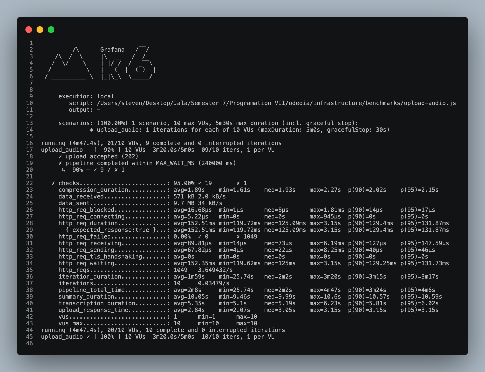
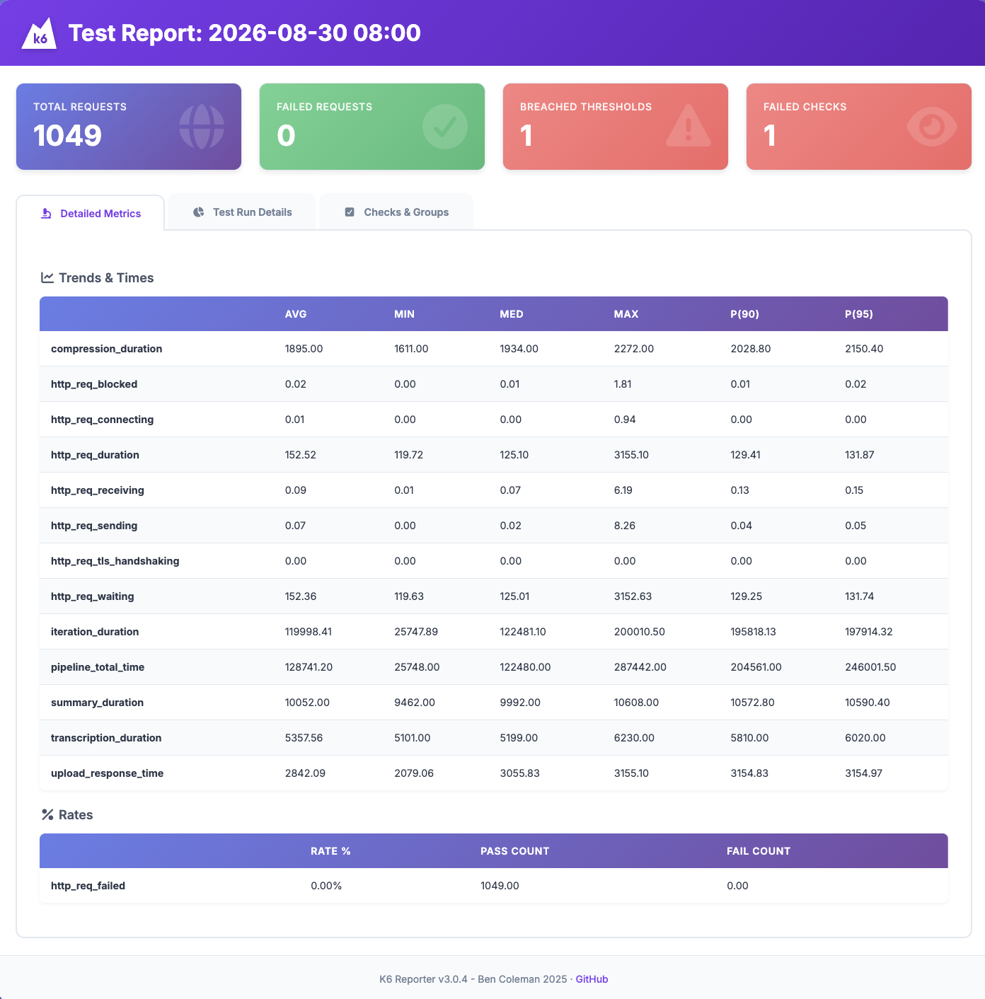
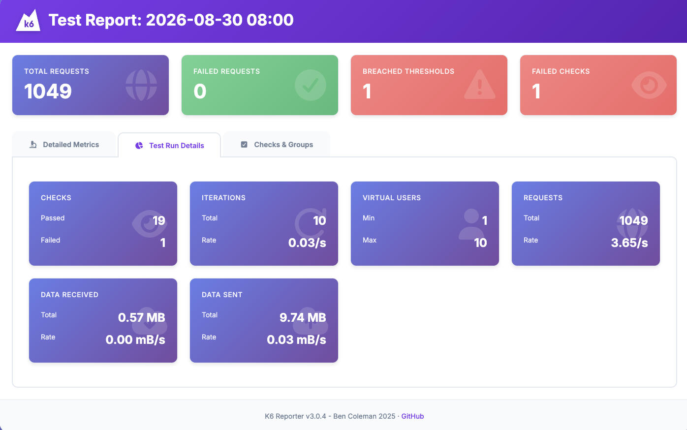
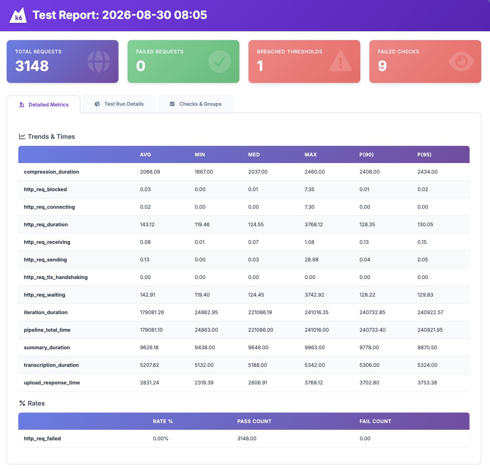
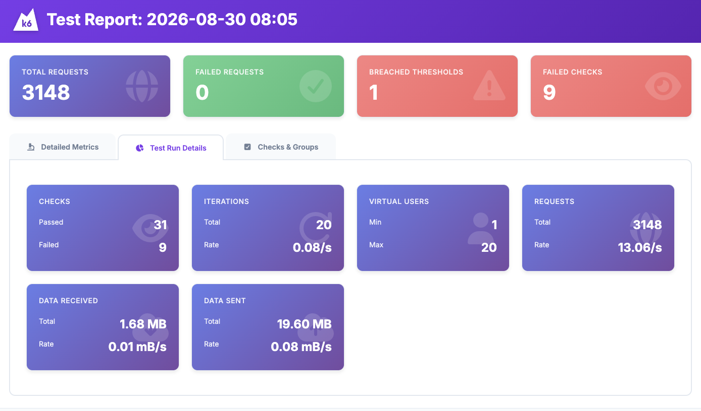
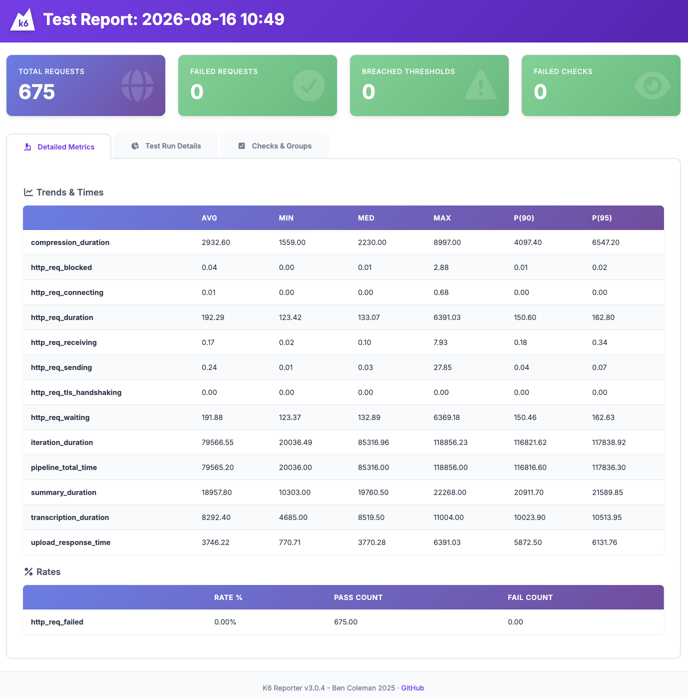
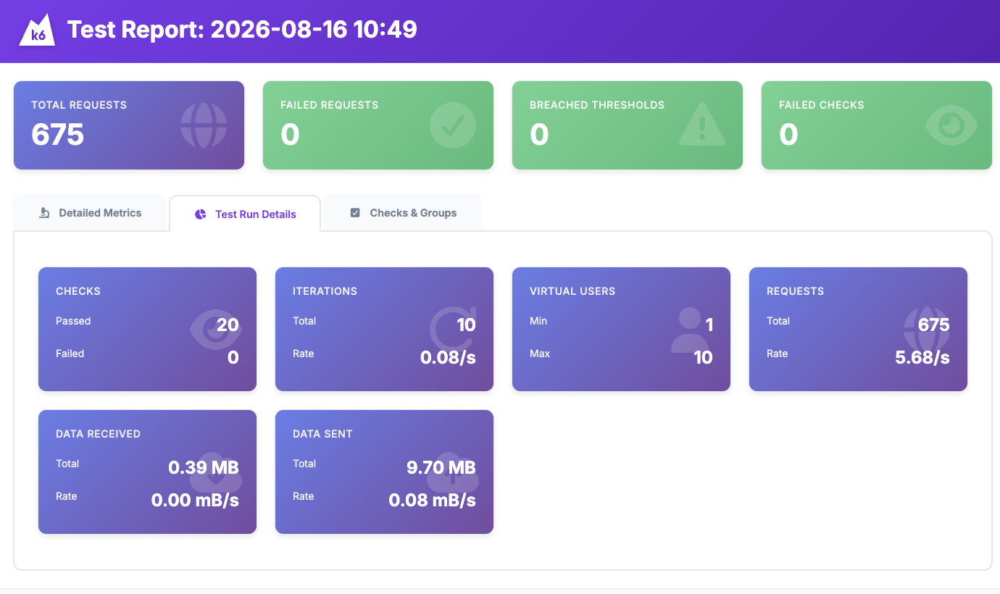
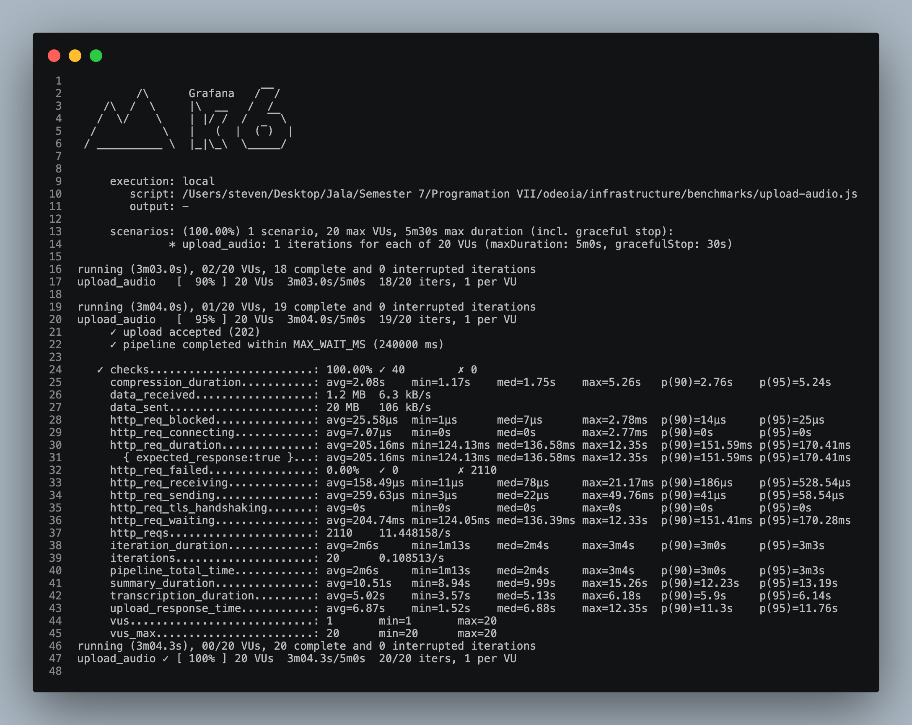
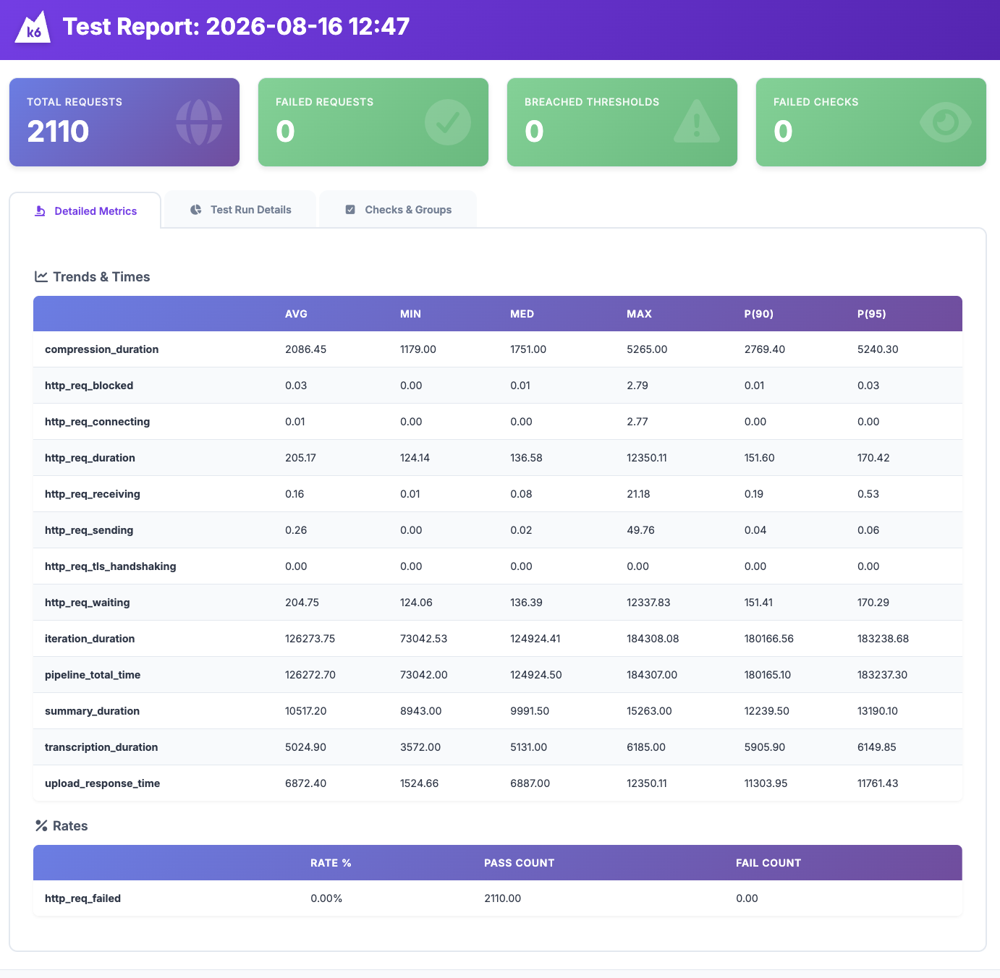
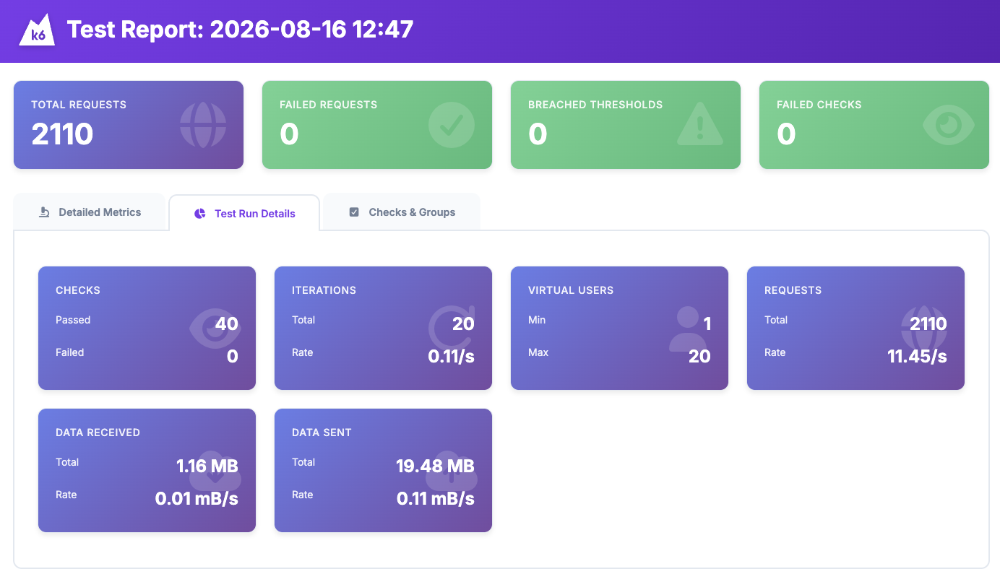

# Programming 7

## Lab Report: Lab #8

**Project Title:** OdeoIA - Audio Processor API
**Student Name:** Oscar Steven Muñoz Fajardo
**Student Email:** [oscar.munoz@jala.university](mailto:oscar.munoz@jala.university)
**Submission Date:** 30/08/2026
**Instructor:** Leopoldo Flores

---

## 1. Introduction

Durante esta semana trabajé en la construcción de una línea base secuencial del proyecto final con el objetivo de comparar su rendimiento frente a la implementación actual de `main`.

Actualmente, `main` incorpora diferentes técnicas orientadas a mejorar el rendimiento del sistema, entre ellas TPL, programación asíncrona, ejecución concurrente y procesamiento paralelo. Por esta razón, necesitaba una versión equivalente del proyecto que mantuviera el mismo flujo funcional, pero ejecutara las operaciones de forma secuencial. El objetivo de esta versión no era realizar una nueva optimización, sino establecer un punto de referencia que permitiera medir el impacto real de las técnicas utilizadas actualmente.

Para construir esto retomé la rama `feat/audio-api-processor` y adapté el flujo existente para eliminar la ejecución concurrente y paralela. En particular, el procesamiento de compresión y el procesamiento de transcripción y resumen dejaron de ejecutarse de manera simultánea. Se mantuvo `Thread` como mecanismo de ejecución, pero cada unidad de trabajo se completa antes de iniciar la siguiente.

A partir de esta implementación ejecuté pruebas de carga utilizando k6 y comparé diferentes configuraciones para observar cómo cambia el rendimiento al introducir progresivamente mecanismos de concurrencia y paralelismo.

El análisis se concentra principalmente en dos aspectos:

* el tiempo necesario para completar el procesamiento de los audios;
* el ahorro de tiempo obtenido al pasar de una ejecución secuencial a una ejecución concurrente y paralela.

De esta manera, la versión secuencial funciona como línea base y `main` representa la evolución del proyecto hacia una arquitectura capaz de procesar una mayor cantidad de trabajo simultáneamente.

---

## 2. Architecture & Implementation

### 2.1 Línea base secuencial

La rama `feat/audio-api-processor` fue utilizada como punto de partida para construir la línea base del proyecto. La implementación conserva el flujo principal de procesamiento:

```text
Upload Audio
     ↓
Compression
     ↓
Transcription
     ↓
Summary
     ↓
Completed
```

La principal diferencia respecto a `main` está en la estrategia de ejecución.

En la línea base, las operaciones se procesan de forma secuencial. Aunque se mantienen `Thread` explícitos como mecanismo de ejecución, no se utiliza `Task`, `async/await`, TPL, `Parallel`, `Task.WhenAll` ni mecanismos equivalentes para ejecutar varias operaciones simultáneamente.

El procesamiento de un audio sigue conceptualmente este flujo:

```text
Audio
  │
  ├── Compression
  │       ↓
  │    Complete
  │
  └── Transcription
          ↓
       Summary
          ↓
       Complete
```

Cada etapa debe terminar antes de continuar con la siguiente unidad de trabajo. Esto permite que la implementación represente un escenario donde existe una capacidad limitada de procesamiento simultáneo.

El procesamiento en segundo plano también fue adaptado para trabajar con un único `Thread`. En cada ciclo se obtiene un registro pendiente, se procesa completamente y solamente después se continúa con el siguiente.

Por lo tanto, la línea base puede resumirse como:

```text
Audio 1 → Complete
              ↓
Audio 2 → Complete
              ↓
Audio 3 → Complete
              ↓
Audio 4 → Complete
```

Este comportamiento permite establecer una referencia clara para posteriormente evaluar qué sucede cuando el sistema puede procesar varios trabajos al mismo tiempo.

### 2.2 Implementación actual en `main`

La implementación de `main` conserva el mismo objetivo funcional, pero cambia la estrategia de ejecución.

Actualmente se utilizan diferentes mecanismos de concurrencia y paralelismo:

* `async/await` para operaciones asíncronas;
* TPL (`Task Parallel Library`);
* `SemaphoreSlim` para controlar el acceso concurrente a recursos;
* `Parallel.ForEachAsync` para procesar múltiples registros de la cola;
* un grado de paralelismo configurado en `3`.

El cambio más importante se encuentra en el procesamiento de la cola. En lugar de esperar a que un audio termine completamente antes de comenzar el siguiente, `main` puede procesar hasta tres registros simultáneamente.

Conceptualmente:

```text
Audio 1 ───────────────→ Complete
Audio 2 ───────────────→ Complete
Audio 3 ───────────────→ Complete
        │
        │ procesamiento simultáneo
        ↓
Audio 4 ───────────────→ Complete
```

Esto permite aprovechar mejor los recursos disponibles y reducir el tiempo necesario para procesar una carga completa.

La configuración utilizada en `main` durante los benchmarks fue:

```text
EXTERNAL_PROCESS_SEMAPHORE_LIMIT = 3
BACKGROUND_PROCESSING_MAX_DEGREE_OF_PARALLELISM = 3
```

La combinación de estas técnicas es importante porque no se trata únicamente de cambiar `Thread` por `Task`. El principal cambio de rendimiento aparece cuando el sistema puede mantener varias unidades de trabajo activas simultáneamente.

---

## 3. Pull Request (PR)

**Pull Request Link:** Pendiente.

---

## 4. Benchmark & Performance Measurements

### 4.1 Metodología

Para evaluar el impacto de las diferentes estrategias de ejecución utilicé k6 para generar carga sobre el endpoint:

```text
POST /api/audio/upload
```

Cada usuario virtual realiza una subida y posteriormente consulta el estado del audio hasta que el pipeline termina.

El flujo evaluado fue:

```text
Upload
  ↓
Compression
  ↓
Transcription
  ↓
Summary
  ↓
Completed
```

Se realizaron pruebas con **10 y 20 usuarios virtuales (VU)**.

Además de comparar directamente la línea base secuencial contra `main`, se utilizaron configuraciones intermedias para observar cómo cambia el comportamiento al introducir progresivamente mecanismos de concurrencia y paralelismo.

La progresión evaluada fue:

```text
Secuencial
    ↓
Thread + SemaphoreSlim
    ↓
TPL + SemaphoreSlim
    ↓
TPL + SemaphoreSlim + Parallel.ForEachAsync
    ↓
Configuración actual de main
```

Las principales métricas utilizadas fueron:

* `pipeline_total_time`: tiempo necesario para completar el pipeline de un audio;
* duración total de la corrida: tiempo necesario para completar la carga completa;
* tasa de finalización: porcentaje de pipelines completados;
* `http_req_duration`: latencia de las peticiones HTTP;
* consumo promedio y máximo de CPU;
* consumo promedio y máximo de memoria.

La métrica principal para evaluar el procesamiento individual es `pipeline_total_time`, mientras que la duración total de la corrida permite observar el impacto de las técnicas cuando existe una carga compuesta por múltiples audios.

---

### 4.2 Comparativa a 10 usuarios virtuales

| Configuración                                           | Duración total | Pipelines completados | Pipeline avg | Pipeline p95 | HTTP avg |
| :------------------------------------------------------ | -------------: | --------------------: | -----------: | -----------: | -------: |
| **Secuencial (`Thread`)**                               |          288 s |          9 / 10 (90%) |      128.7 s |      246.0 s | 152.5 ms |
| **Thread + SemaphoreSlim (3)**                          |          117 s |        10 / 10 (100%) |       86.0 s |      114.1 s | 238.8 ms |
| **TPL + SemaphoreSlim (3)**                             |          130 s |        10 / 10 (100%) |       99.4 s |      126.6 s | 176.4 ms |
| **TPL + SemaphoreSlim (3) + Parallel.ForEachAsync (3)** |      **120 s** |    **10 / 10 (100%)** |   **79.6 s** |  **117.8 s** | 192.3 ms |

Los resultados muestran una diferencia importante entre la línea base y la implementación actual.

Con 10 usuarios virtuales, la versión secuencial necesitó **288 segundos** para completar la carga, mientras que `main` la completó en **120 segundos**.

Esto representa una reducción de:

**168 segundos**, equivalente a un **58.3% menos de tiempo total de ejecución**.

Si se observa únicamente el tiempo promedio de procesamiento de cada audio, el resultado también es favorable:

```text
Secuencial: 128.7 s
main:        79.6 s

Ahorro:      49.2 s
Ahorro:      38.2%
```

La mejora no solamente se refleja en el tiempo. La implementación secuencial completó 9 de los 10 pipelines, mientras que `main` completó los 10.

---

### 4.3 Comparativa a 20 usuarios virtuales

| Configuración                                           | Duración total | Pipelines completados | Pipeline avg | Pipeline p95 | HTTP avg |
| :------------------------------------------------------ | -------------: | --------------------: | -----------: | -----------: | -------: |
| **Secuencial (`Thread`)**                               |          242 s |         11 / 20 (55%) |      179.1 s |      240.9 s | 143.1 ms |
| **TPL + SemaphoreSlim (3)**                             |          241 s |         13 / 20 (65%) |      196.0 s |      240.8 s | 176.9 ms |
| **TPL + SemaphoreSlim (3) + Parallel.ForEachAsync (3)** |      **184 s** |    **20 / 20 (100%)** |  **126.3 s** |  **183.2 s** | 205.2 ms |

A 20 usuarios virtuales la diferencia entre ambas implementaciones es todavía más relevante.

La línea base secuencial necesitó 242 segundos y solamente consiguió completar 11 de los 20 pipelines dentro de la ventana disponible.

En cambio, `main` completó los **20 pipelines**, reduciendo la duración total de la carga a **184 segundos**.

Esto representa:

```text
Secuencial: 242 s
main:       184 s

Ahorro:      58 s
Ahorro:      24.0%
```

También existe una reducción significativa en el tiempo promedio por pipeline:

```text
Secuencial: 179.1 s
main:       126.3 s

Ahorro:      52.8 s
Ahorro:      29.5%
```

En este escenario, el beneficio del paralelismo no se limita a terminar más rápido. La diferencia más importante es la capacidad del sistema para completar la carga completa.

---

### 4.4 Ahorro de tiempo respecto a la línea base

Tomando la implementación secuencial como referencia, los resultados obtenidos para `main` son:

| VUs | Métrica           | Secuencial |  `main` | Diferencia |    Ahorro |
| :-- | :---------------- | ---------: | ------: | ---------: | --------: |
| 10  | Pipeline promedio |    128.7 s |  79.6 s |     49.2 s | **38.2%** |
| 10  | Duración total    |      288 s |   120 s |      168 s | **58.3%** |
| 20  | Pipeline promedio |    179.1 s | 126.3 s |     52.8 s | **29.5%** |
| 20  | Duración total    |      242 s |   184 s |       58 s | **24.0%** |

Estos resultados permiten observar que el uso de concurrencia y paralelismo tiene un impacto directo sobre el tiempo de procesamiento.

A 10 usuarios virtuales, la duración total de la carga se reduce en más de la mitad.

A 20 usuarios virtuales, aunque la carga es mayor y los recursos disponibles comienzan a ser un factor limitante, `main` todavía consigue reducir el tiempo total y, principalmente, completar todos los pipelines.

---

## 5. Performance Analysis

### 5.1 Impacto de la concurrencia

La comparación muestra que el principal beneficio de la concurrencia consiste en evitar que todo el sistema dependa de una única unidad de trabajo ejecutándose de principio a fin.

En la versión secuencial, el procesamiento se comporta esencialmente como una cola:

```text
Audio 1 → Audio 2 → Audio 3 → Audio 4
```

Si un audio requiere una cantidad considerable de tiempo para compresión, transcripción o resumen, los siguientes trabajos deben esperar.

En `main`, diferentes unidades de trabajo pueden encontrarse en ejecución al mismo tiempo:

```text
Audio 1 ───────────────→
Audio 2 ───────────────→
Audio 3 ───────────────→
```

El resultado es una mejor utilización de los recursos disponibles y una reducción del tiempo necesario para procesar una carga completa.

### 5.2 Impacto del paralelismo

El cambio más significativo aparece al permitir que varios registros de la cola sean procesados simultáneamente mediante `Parallel.ForEachAsync` con un grado de paralelismo de 3.

Esta configuración permite mantener hasta tres unidades de procesamiento activas al mismo tiempo.

Por esta razón, considero que esta es una de las optimizaciones más relevantes de la implementación actual. No solamente reduce el tiempo de procesamiento de un conjunto de solicitudes, sino que también aumenta la capacidad del sistema para atender una carga mayor.

Los resultados a 20 usuarios virtuales muestran claramente este comportamiento. Mientras la implementación secuencial completó 11 de 20 pipelines, `main` consiguió completar los 20.

Por lo tanto, el paralelismo no debe evaluarse únicamente como una reducción de segundos. También debe considerarse su impacto sobre la **capacidad de procesamiento del sistema**.

### 5.3 El papel de TPL y la asincronía

La utilización de `async/await` y TPL permite estructurar el trabajo de manera más flexible y administrar operaciones que no necesitan mantener un hilo bloqueado durante toda su ejecución.

Sin embargo, los resultados también muestran que la asincronía por sí sola no garantiza una mejora de rendimiento.

La configuración TPL + `SemaphoreSlim`, sin el paralelismo adicional sobre la cola, obtuvo:

```text
VU10 → 99.4 s por pipeline
VU20 → 196.0 s por pipeline
```

Mientras que `main`, incorporando además `Parallel.ForEachAsync`, obtuvo:

```text
VU10 → 79.6 s por pipeline
VU20 → 126.3 s por pipeline
```

Esto permite distinguir dos conceptos que inicialmente pueden parecer equivalentes:

```text
Asincronía
→ permite administrar mejor operaciones que esperan recursos.

Paralelismo
→ permite ejecutar múltiples unidades de trabajo simultáneamente.
```

En este proyecto, la combinación de ambos es la que genera el resultado más favorable.

### 5.4 Costo de utilizar paralelismo

El incremento de rendimiento tiene un costo asociado: el consumo de recursos.

La versión secuencial presentó un consumo promedio de CPU cercano al uso de uno o dos núcleos:

```text
VU10 → 137.3%
VU20 → 142.0%
```

Mientras que las configuraciones concurrentes alcanzaron valores considerablemente superiores.

La configuración de `main` presentó:

```text
VU10 → 415.7% CPU promedio
VU20 → 431.7% CPU promedio
```

Esto evidencia que la reducción del tiempo no ocurre de manera gratuita. El sistema utiliza más recursos de CPU para mantener varias unidades de trabajo activas simultáneamente.

Desde mi perspectiva, este es precisamente uno de los puntos importantes de la comparación: **la concurrencia y el paralelismo permiten obtener mayor rendimiento utilizando de forma más intensiva los recursos disponibles**.

Por lo tanto, la decisión de utilizar estas técnicas debe considerar el balance entre tiempo de ejecución, capacidad de procesamiento y recursos disponibles.

---

## 6. Execution Results & Empirical Evidence

### 6.1 Console Outputs & Logs

#### Flujo secuencial unicamente con threads - VU10:





#### Flujo secuencial unicamente con threads - VU20:





#### Flujo concurrente con TPL + SemaphoreSlim + Parallel - VU10:




#### Flujo concurrente con TPL + SemaphoreSlim + Parallel - VU20:





## 7. Self-Assessment

Durante esta semana el principal trabajo consistió en recuperar una versión anterior del proyecto y transformarla en una línea base que pudiera utilizarse para realizar una comparación experimental con `main`.

El reto principal fue mantener el flujo funcional del proyecto mientras se modificaba únicamente la estrategia de ejecución. Esto era importante porque una comparación de rendimiento pierde valor si las dos versiones realizan operaciones diferentes.

Por esta razón, mantuve las mismas etapas principales de procesamiento y concentré los cambios en la forma en que estas operaciones son ejecutadas.

La ejecución de los benchmarks también permitió observar que no todas las técnicas de concurrencia producen necesariamente el mismo resultado. La diferencia más significativa aparece cuando el sistema puede procesar varias unidades de trabajo simultáneamente, especialmente mediante `Parallel.ForEachAsync`.

Considero que esta evaluación permitió observar de manera más clara la evolución del proyecto: la versión secuencial funciona como una referencia sencilla y `main` muestra cómo las técnicas de concurrencia, asincronía y paralelismo permiten aprovechar mejor los recursos disponibles.

---

## 8. Conclusions

La construcción de la línea base secuencial permitió establecer una referencia para medir el impacto de las optimizaciones incorporadas actualmente en `main`.

Los resultados muestran que la implementación actual presenta una mejora significativa frente a la ejecución secuencial.

A 10 usuarios virtuales:

```text
Duración total:
288 s → 120 s

Ahorro:
58.3%
```

A 20 usuarios virtuales:

```text
Duración total:
242 s → 184 s

Ahorro:
24.0%
```

Además del ahorro de tiempo, existe una diferencia importante en la capacidad de procesamiento. Con 20 usuarios virtuales, la versión secuencial completó 11 de 20 pipelines, mientras que `main` completó los 20.

Esto permite concluir que el beneficio de la concurrencia y el paralelismo no se limita a reducir el tiempo de ejecución. También permite que el sistema pueda manejar una carga mayor dentro de una misma ventana de tiempo.

Otro resultado importante es que la asincronía por sí sola no representa necesariamente una mejora. En este proyecto, el mayor impacto aparece al combinar las operaciones asíncronas con paralelismo real sobre la cola de procesamiento.

En particular, `Parallel.ForEachAsync` con grado de paralelismo 3 representa una mejora importante porque permite procesar varias unidades de trabajo simultáneamente en lugar de esperar a que cada audio termine completamente antes de comenzar el siguiente.

Finalmente, los resultados muestran el trade-off esperado: la implementación paralela utiliza más CPU para conseguir menores tiempos de ejecución. Esto significa que las técnicas de concurrencia y paralelismo deben utilizarse considerando tanto el rendimiento esperado como la capacidad de los recursos disponibles.

En conclusión, la comparación confirma que la evolución hacia una arquitectura concurrente y paralela tiene un impacto positivo sobre el rendimiento del proyecto. La implementación actual de `main` consigue procesar la carga de manera más eficiente y, especialmente bajo mayor concurrencia, demuestra una mayor capacidad para completar los trabajos solicitados.
