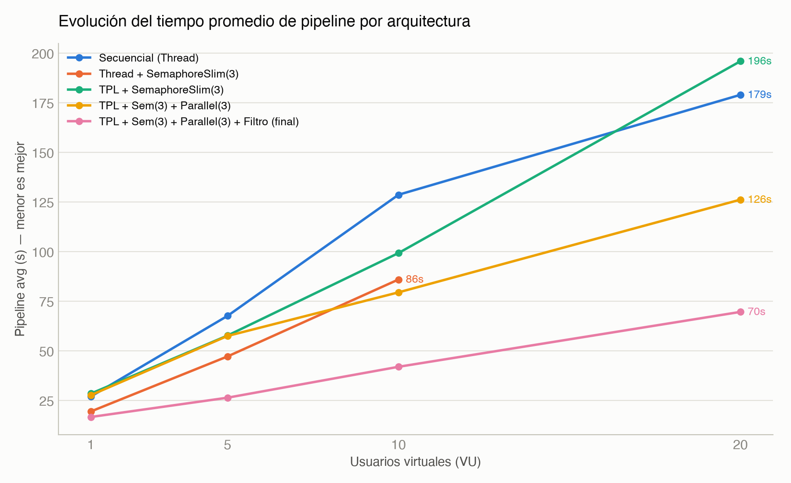
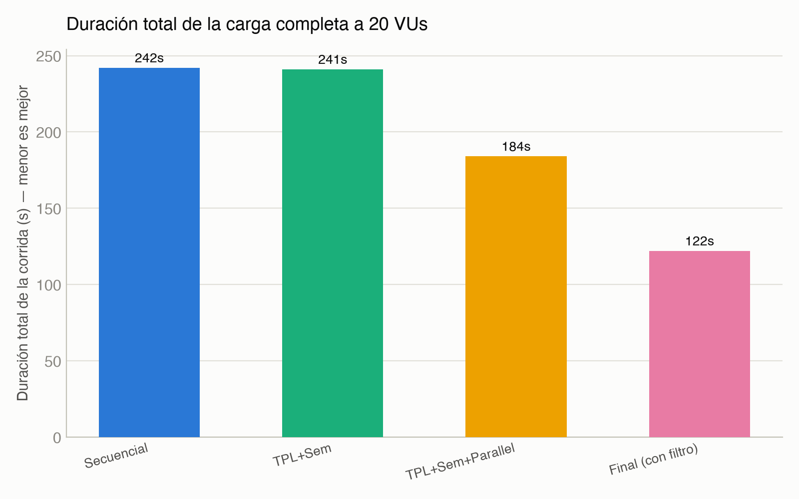
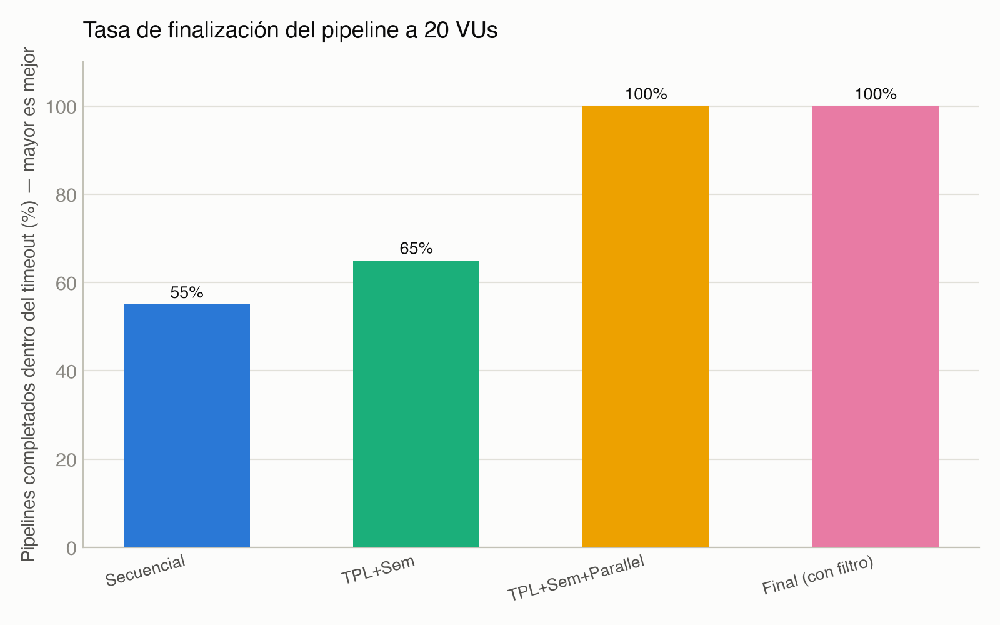
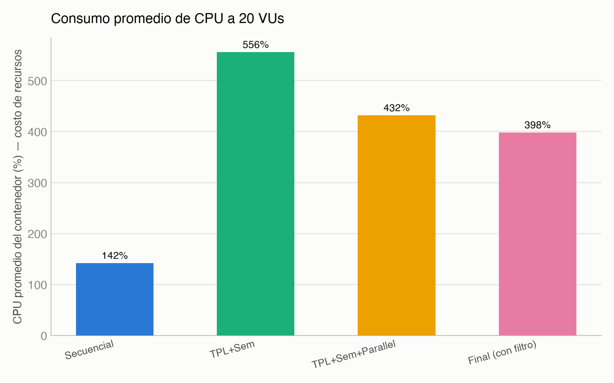
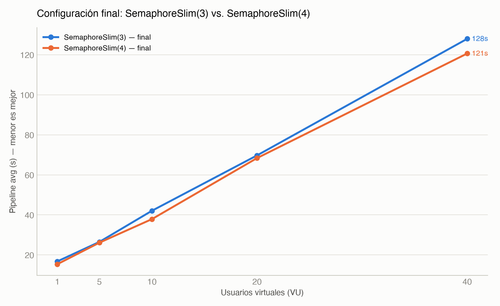
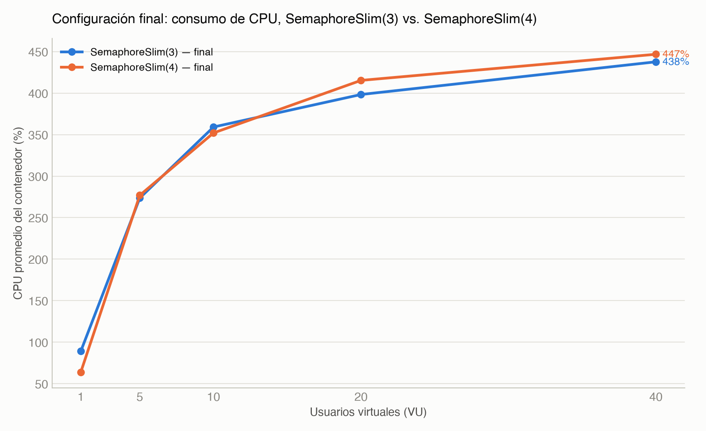
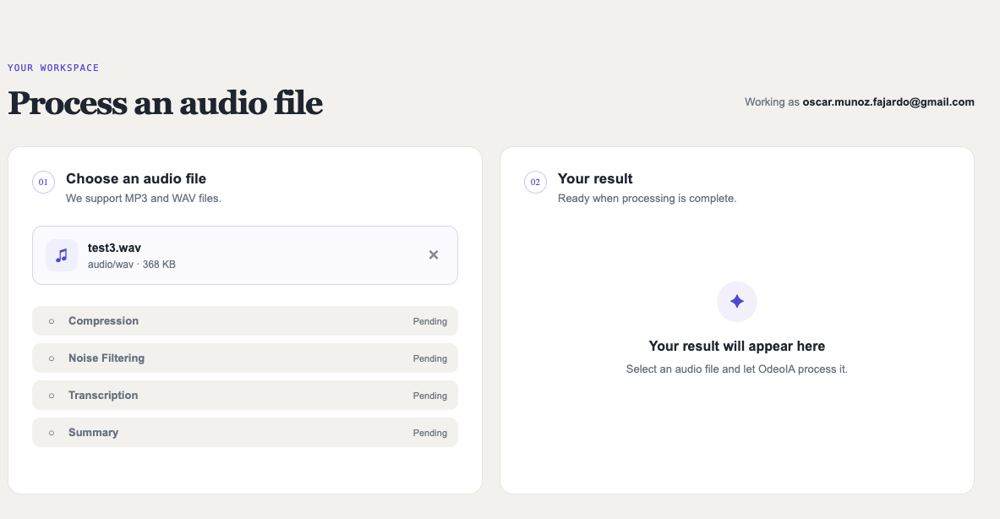
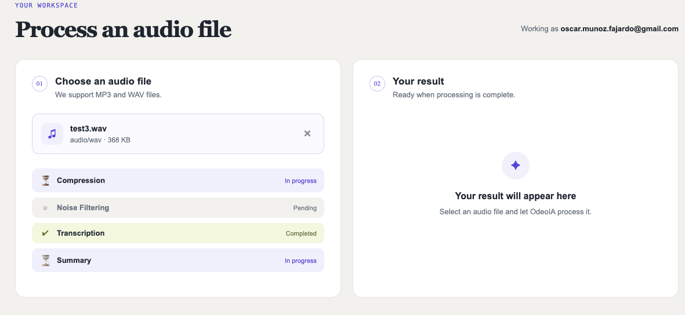
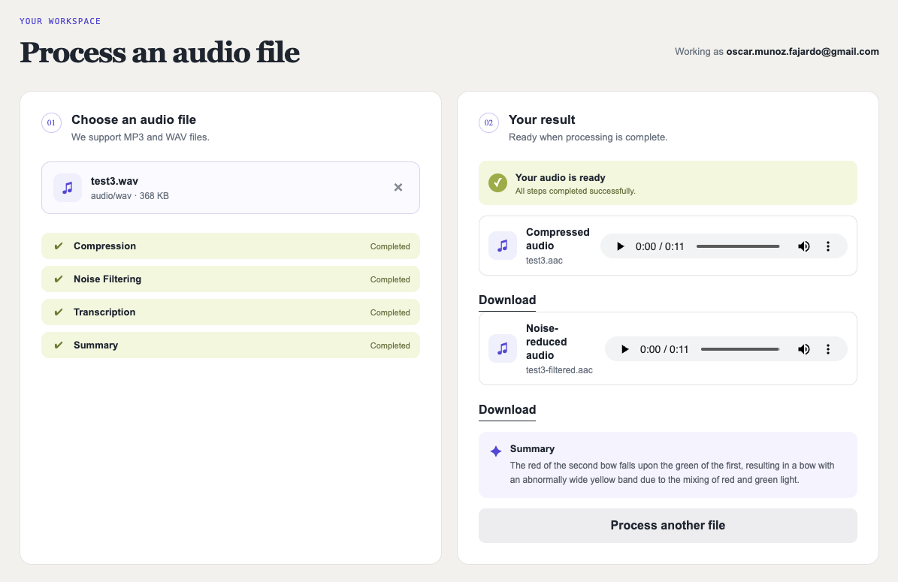

# Programming 7

## Lab Report: Lab #9

**Project Title:** OdeoIA - Audio Processor API
**Student Name:** Oscar Steven Muñoz Fajardo
**Student Email:** oscar.munoz@jala.university
**Submission Date:** 04/09/2026
**Instructor:** Leopoldo Flores

---

## 1. Introduction

Esta semana agregué una nueva etapa al pipeline de procesamiento de audio: la reducción de ruido. El resultado de esta etapa se guarda en el almacenamiento de archivos para que pueda ser utilizado posteriormente desde el cliente.

Del lado del cliente, agregué una vista previa para poder reproducir las dos versiones del audio: el audio comprimido original y el audio después de aplicar la reducción de ruido. De esta forma, el resultado del filtro puede comprobarse directamente desde la aplicación.

Además, terminé una optimización que había quedado pendiente de la semana anterior. El procesamiento paralelo ahora utiliza un sistema de slots que permite aprovechar un espacio disponible inmediatamente, sin tener que esperar a que termine todo el grupo de audios que estaba siendo procesado.

También cambié la forma en que el frontend recibe los cambios de estado. Antes consultaba periódicamente el backend para saber si una etapa había terminado. Ahora el backend envía una notificación mediante SignalR cuando existe un cambio, y el frontend consulta nuevamente el estado solo cuando recibe esa notificación.

Como trabajo adicional, también comparé diferentes configuraciones de concurrencia utilizando los benchmarks existentes. Esto permitió comprobar cómo fue mejorando el procesamiento desde una implementación secuencial hasta la arquitectura actual y decidir entre `SemaphoreSlim(3)` y `SemaphoreSlim(4)`.

**Target Objective:** Agregar una etapa de reducción de ruido al pipeline del servidor, guardar el resultado en el almacenamiento de archivos y permitir desde el cliente la reproducción tanto del audio comprimido como del audio filtrado.

---

## 2. Architecture & Implementation

### 2.1 Reducción de ruido en el servidor

El pipeline de procesamiento ahora tiene una etapa adicional después de la compresión.

El flujo queda de la siguiente forma:

```text
Audio original
      ↓
Compresión
      ↓
Audio comprimido
      ↓
Reducción de ruido
      ↓
Audio filtrado
```

Primero se genera el audio comprimido y se guarda en el almacenamiento. Después, ese mismo resultado se utiliza como entrada para la reducción de ruido. El audio filtrado también se guarda en el almacenamiento y su URL queda asociada al registro del audio.

Decidí mantener la reducción de ruido dentro del mismo flujo que ya realizaba la compresión. De esta manera, no fue necesario crear otro flujo paralelo y se mantiene la estructura existente del pipeline.

Cuando comienza la reducción de ruido, el estado de esta etapa pasa a `Processing`. Cuando termina correctamente, se guarda la URL del archivo generado y el estado pasa a `Completed`.

Si la reducción de ruido falla, el error se registra como `Failed`, pero la compresión no se pierde porque ya había sido completada y almacenada antes de ejecutar el filtro.

Para aplicar el filtro se utiliza FFmpeg con `afftdn`, que permite reducir el ruido presente en el audio.

La configuración utilizada fue:

```text
-afftdn=nr=25:nf=-35:tn=1
```

El parámetro `tn=1` permite que el filtro adapte el piso de ruido durante el procesamiento. También ajusté los valores de reducción porque la configuración por defecto producía un cambio muy poco perceptible en las pruebas.

El filtro mantiene el audio en formato AAC y con una tasa de bits de 192 kbps, de forma que el resultado pueda seguir siendo utilizado dentro del flujo actual.

Además, la ejecución de FFmpeg continúa respetando el límite de concurrencia utilizado para controlar los procesos externos más pesados. Esto evita iniciar una cantidad excesiva de procesos al mismo tiempo.

---

### 2.2 Vista previa dual en el cliente

En el cliente agregué un segundo reproductor para los audios que ya tienen disponible el resultado de la reducción de ruido.

Ahora cada audio procesado puede mostrar:

- Audio comprimido.
- Audio con reducción de ruido.

Cada versión tiene su propio reproductor y su enlace de descarga.

La lógica se agregó al componente que ya se utilizaba para mostrar los resultados de un audio individual y de los audios de la lista. Por esta razón, el cambio se aplica automáticamente en ambas vistas y no fue necesario duplicar la implementación.

El resultado esperado es que el usuario pueda escuchar primero el audio comprimido y después el audio filtrado para comparar directamente ambos resultados.

---

### 2.3 Automatización del procesamiento paralelo

Una de las mejoras más importantes de esta semana fue completar el cambio que había identificado en el profiling anterior.

El problema estaba en la forma en que se reclamaban nuevos audios para procesar. `Parallel.ForEachAsync` trabajaba por grupos: primero esperaba a que terminara todo el grupo actual y solamente después podía comenzar a reclamar nuevos trabajos.

Esto generaba un problema cuando un audio tardaba mucho más que los demás. Aunque otro audio terminara rápidamente y hubiera capacidad disponible, el sistema tenía que esperar al audio más lento del grupo antes de continuar.

Para resolverlo, reemplacé ese comportamiento por un sistema de slots usando `SemaphoreSlim(N,N)` a nivel de clase.

El funcionamiento ahora es más sencillo:

```text
                 ┌── Audio 1
N slots ─────────┼── Audio 2
                 └── Audio 3

Audio 2 termina
      ↓
Libera un slot
      ↓
Nuevo audio entra inmediatamente
```

El polling puede reclamar y despachar nuevos trabajos sin esperar a que termine todo lo que ya está en ejecución.

Cuando un audio termina, libera su slot y el siguiente audio puede ocuparlo inmediatamente. Esto también funciona entre diferentes ciclos de polling.

Por ejemplo, si hay tres slots ocupados y uno de los audios termina rápidamente, el siguiente audio disponible puede comenzar sin esperar a que terminen los otros dos.

Para validar el cambio agregué una prueba en la que un audio tarda bastante más que los demás. Con la implementación anterior, un audio reclamado posteriormente tenía que esperar a que terminara todo el grupo. Con el nuevo sistema, comienza cuando existe un slot disponible.

El resultado confirma que el cambio elimina uno de los cuellos de botella que había sido identificado en el profiling.

---

### 2.4 Notificaciones en tiempo real con SignalR

También cambié la forma en que el frontend conoce el estado del procesamiento.

Anteriormente, mientras un audio estaba siendo procesado, el frontend hacía una consulta cada cierto tiempo para preguntar por su estado. Esto generaba solicitudes aunque el estado no hubiera cambiado.

Ahora se utiliza SignalR para enviar una notificación cuando cambia el estado de un audio.

El flujo es:

```text
Backend actualiza estado
        ↓
SignalR envía notificación
        ↓
Frontend recibe evento
        ↓
Frontend consulta el estado actualizado
```

El backend expone un hub de SignalR y cada cliente se suscribe al audio que está procesando.

Cuando el backend persiste un cambio de estado, envía una notificación al grupo correspondiente. El frontend recibe el evento y en ese momento obtiene nuevamente el estado completo.

Con este cambio ya no es necesario mantener un temporizador ejecutando consultas cada pocos segundos. La comunicación ocurre únicamente cuando existe un cambio que el cliente necesita conocer.

---

### 2.5 Nota adicional: concurrencia en las subidas a Supabase

Como parte de las pruebas de carga también revisé un problema que ya había aparecido anteriormente con las subidas a Supabase Storage.

El problema se presenta cuando varias subidas ocurren de manera realmente concurrente utilizando el mismo cliente de Storage. En las pruebas anteriores esto podía producir errores intermitentes.

La solución que estaba implementada consistía en utilizar un `SemaphoreSlim(1,1)` para serializar todas las subidas. Aunque esto evitaba los errores, también eliminaba parte del paralelismo del sistema porque las subidas terminaban ejecutándose una detrás de otra.

Esta semana quité esa serialización del backend y agregué un pequeño retraso (0 - 2s) aleatorio en el benchmark. La intención es evitar que todos los usuarios virtuales realicen la solicitud exactamente al mismo tiempo durante las pruebas.

Esta medida sirve como mitigación para el benchmark, pero no soluciona el problema de fondo. Si existe tráfico real con muchas subidas concurrentes, el problema puede volver a presentarse.

Por esta razón, lo dejo como un riesgo conocido y no como un problema completamente resuelto. Una solución definitiva tendría que evaluar otra forma de manejar el cliente de Storage o una versión del SDK que no presente este comportamiento.

---

## 3. Pull Request (PR)

**Pull Request Link:** Pendiente.

---

## 4. Benchmark & Performance Measurements

Esta sección es adicional al objetivo principal de la semana. La incluí para preparar la comparación que utilizaré en la presentación final.

La idea es mostrar cómo fue evolucionando la arquitectura de concurrencia y comprobar con datos qué cambios tuvieron un efecto real en el rendimiento.

### 4.1 Metodología

Se utilizaron diferentes ejecuciones de k6 realizadas durante el desarrollo del proyecto.

La evolución analizada fue:

```text
Procesamiento secuencial
        ↓
Thread + SemaphoreSlim(3)
        ↓
TPL + SemaphoreSlim(3)
        ↓
TPL + SemaphoreSlim(3) + Parallel.ForEachAsync(3)
        ↓
Arquitectura final
```

Todas las pruebas utilizaron el mismo audio y el mismo endpoint de subida. La medición se realizó esperando hasta que el pipeline completo terminara.

Para comparar la evolución se utilizaron cargas de 1, 5, 10 y 20 VUs.

Para comparar `SemaphoreSlim(3)` y `SemaphoreSlim(4)` se utilizaron 1, 5, 10, 20 y 40 VUs.

Existe una diferencia en una de las pruebas antiguas: la ejecución original con `Thread + SemaphoreSlim` tenía un timeout de 120 segundos, mientras que las demás utilizaban 240 segundos. Por esta razón, no utilicé esa ejecución para comparar resultados a 20 VUs, ya que el porcentaje de finalización estaba afectado por el timeout y no únicamente por la arquitectura.

---

### 4.2 Evolución del tiempo de pipeline



El resultado más importante de esta comparación es que utilizar `async/await` y TPL por sí solo no garantiza una mejora de rendimiento.

La configuración con TPL y `SemaphoreSlim`, pero sin paralelismo real sobre la cola de trabajos, terminó siendo una de las más lentas a partir de 10 VUs.

A 20 VUs incluso fue más lenta que la versión completamente secuencial:

```text
Secuencial:       179 s
TPL + Semaphore:  196 s
```

Esto permite ver que la asincronía y el paralelismo solucionan problemas diferentes. Hacer el código asíncrono no significa automáticamente que más audios estén siendo procesados al mismo tiempo.

La mejora importante aparece cuando se permite procesar varios audios de manera concurrente y, especialmente, cuando los nuevos trabajos pueden ocupar un slot tan pronto como queda disponible.

La arquitectura final presenta un crecimiento mucho más estable del tiempo promedio de pipeline:

```text
17 s → 27 s → 42 s → 70 s
```

---

### 4.3 Duración total y tasa de finalización a 20 VUs





Estos dos resultados deben analizarse juntos.

Una configuración puede parecer rápida simplemente porque no alcanza a completar todos los pipelines. Por eso, además del tiempo total, es necesario revisar cuántos audios realmente terminaron.

A 20 VUs:

- La versión secuencial completó el 55%.
- TPL + Semaphore sin paralelismo real completó el 65%.
- La versión con `Parallel.ForEachAsync` alcanzó el 100%.
- La arquitectura final también alcanzó el 100%.

Además, la arquitectura final redujo la duración total de la corrida:

```text
Secuencial → Arquitectura final

242 s → 122 s

Reducción: 49.6%
```

Comparada con la versión inmediatamente anterior a la arquitectura final:

```text
184 s → 122 s

Reducción: 33.7%
```

Por lo tanto, no solamente se redujo el tiempo. También se logró completar el 100% de los pipelines dentro del tiempo disponible.

---

### 4.4 Consumo de CPU



El resultado más interesante del consumo de CPU es que la configuración con TPL y `SemaphoreSlim`, pero sin paralelismo real, fue la que más CPU utilizó:

```text
556% de CPU promedio
```

A pesar de eso, fue una de las configuraciones más lentas y tuvo una menor tasa de finalización.

Esto muestra que consumir más CPU no necesariamente significa procesar más rápido. En este caso, parte de los recursos se estaban utilizando mientras el sistema esperaba para admitir nuevos trabajos.

La arquitectura final utilizó menos CPU que la versión anterior:

```text
Versión anterior: 432%
Arquitectura final: 398%
```

Esto ocurrió incluso después de agregar la etapa de reducción de ruido.

Por lo tanto, la mejora no provino simplemente de utilizar más recursos. El principal cambio fue mejorar la forma en que se administran los trabajos concurrentes.

---

### 4.5 Configuración final: `SemaphoreSlim(3)` o `SemaphoreSlim(4)`

Como último punto de la comparación, probé `SemaphoreSlim(3)` y `SemaphoreSlim(4)` utilizando la arquitectura final.





`SemaphoreSlim(4)` fue igual o más rápido en los cinco niveles de carga probados.

La diferencia estuvo entre 1.4% y 9.9% menos tiempo promedio de pipeline y no hubo ningún escenario en el que `SemaphoreSlim(3)` fuera más rápido.

A 40 VUs también hubo una diferencia en la tasa de finalización:

```text
SemaphoreSlim(4): 100%
SemaphoreSlim(3): 97.5%
```

El consumo de CPU fue muy similar entre ambas configuraciones. La diferencia estuvo alrededor de ±4% dependiendo de la carga, sin una tendencia clara que favoreciera a una de las dos.

Por los resultados obtenidos, utilizaré `SemaphoreSlim(4)` en la presentación final.

La diferencia de rendimiento no es enorme, pero `SemaphoreSlim(4)` fue consistentemente mejor en las pruebas realizadas y no presentó un costo de CPU adicional significativo.

---

## 5. Execution Results & Empirical Evidence

La implementación permite comprobar el funcionamiento completo de la nueva etapa.

El flujo esperado es:

```text
Upload
  ↓
Compresión
  ↓
Audio comprimido disponible
  ↓
Reducción de ruido
  ↓
Audio filtrado disponible
  ↓
Frontend recibe los cambios mediante SignalR
  ↓
Usuario puede reproducir ambas versiones
```





---

## 6. Self-Assessment, Blockers & Bugs

### Cuello de botella en la admisión de trabajos — resuelto

El profiling anterior mostró que uno de los principales problema bajo carga no estaba necesariamente en las etapas de procesamiento, sino en la forma en que se admitían nuevos trabajos.

`Parallel.ForEachAsync` esperaba a que terminara todo un grupo antes de continuar. Esto podía dejar capacidad disponible sin utilizar cuando un audio lento mantenía bloqueado el grupo.

El cambio a un sistema de slots con `SemaphoreSlim` y despacho independiente elimina este comportamiento.

La solución fue validada mediante una prueba con un audio lento y otros audios más rápidos. El resultado confirma que un slot puede reutilizarse inmediatamente después de que un audio termina.

### Problema de concurrencia en Supabase Storage — mitigado

El problema de concurrencia en las subidas no está completamente solucionado.

Anteriormente se evitaba utilizando un `SemaphoreSlim(1,1)`, pero esto serializaba todas las subidas.

Ahora el benchmark utiliza un pequeño retraso aleatorio para evitar que todas las solicitudes comiencen exactamente al mismo tiempo. Esto permite probar mejor el paralelismo del backend, pero no elimina el problema que puede aparecer con tráfico real altamente concurrente.

Por ahora queda como riesgo conocido.

### Ajuste del filtro de reducción de ruido

También fue necesario probar diferentes parámetros de `afftdn`.

Los valores por defecto producían una reducción de ruido poco perceptible en los audios utilizados para las pruebas. Por esta razón, ajusté los parámetros manualmente y realicé varias pruebas de escucha.

El resultado depende bastante del tipo de ruido presente en el audio. El filtro funciona mejor en ciertos tipos de ruido, especialmente ruido de alta frecuencia, mientras que puede ser menos efectivo cuando el ruido de fondo está mezclado con la voz en frecuencias bajas.

---

## 7. Conclusions

La implementación de esta semana permitió completar la nueva etapa de reducción de ruido y hacer que el resultado esté disponible desde el cliente junto con el audio comprimido.

Además, el cambio en el procesamiento paralelo confirmó lo encontrado durante el profiling anterior: el problema principal no estaba únicamente en cuánto tardaba cada etapa, sino en cómo se admitían nuevos trabajos.

El cambio de un procesamiento por lotes a un sistema de slots permite aprovechar inmediatamente la capacidad disponible. Esto mejora el uso de los recursos y reduce el tiempo total de procesamiento bajo carga.

También pude comprobar que utilizar `async/await` no significa necesariamente que exista paralelismo real. En las pruebas, la configuración que utilizaba TPL y `SemaphoreSlim` sin paralelismo sobre la cola llegó a ser más lenta y consumir más CPU que la versión secuencial.

Por otro lado, la comparación entre `SemaphoreSlim(3)` y `SemaphoreSlim(4)` mostró una ventaja consistente para `SemaphoreSlim(4)`. Aunque la diferencia no es muy grande, fue la mejor configuración en las pruebas realizadas y mantuvo una tasa de finalización del 100% a 40 VUs.

Finalmente, el cambio a SignalR elimina el polling periódico del frontend. Ahora el cliente recibe una notificación cuando existe un cambio y solo en ese momento consulta el estado actualizado.

---

## 8. Recommendations

- Mantener `SemaphoreSlim(4)` como configuración de referencia para la presentación final, ya que fue la opción con mejores resultados en los benchmarks realizados.

- Buscar una solución definitiva para el problema de concurrencia de Supabase Storage antes de utilizar el sistema con tráfico real altamente concurrente. La mitigación actual está orientada principalmente a las pruebas de carga.

- Como siguiente optimización, revisar la etapa de generación del resumen, ya que continúa siendo una de las partes más costosas del flujo de Transcripción → Resumen según el profiling anterior.

- Mantener la comunicación mediante SignalR para los cambios de estado, evitando volver al polling periódico mientras no exista una necesidad específica de hacerlo.
